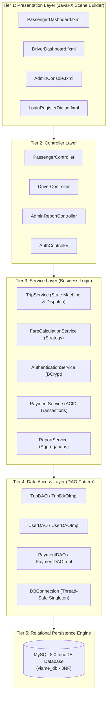
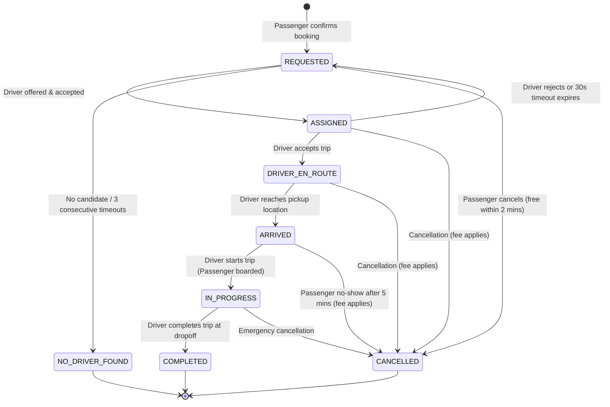
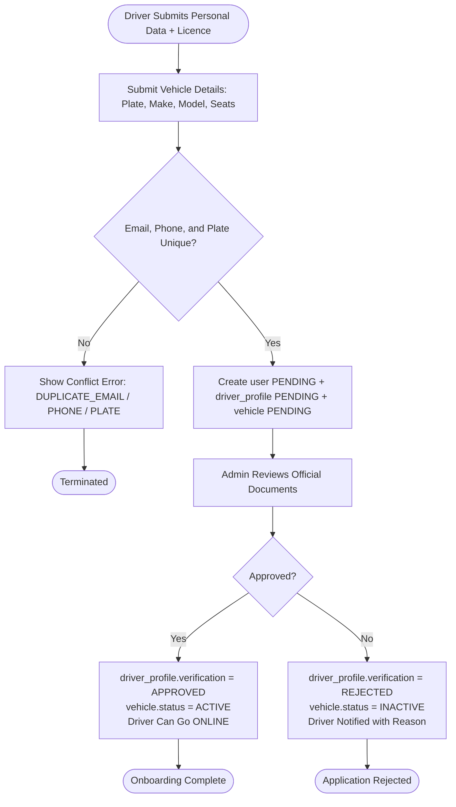
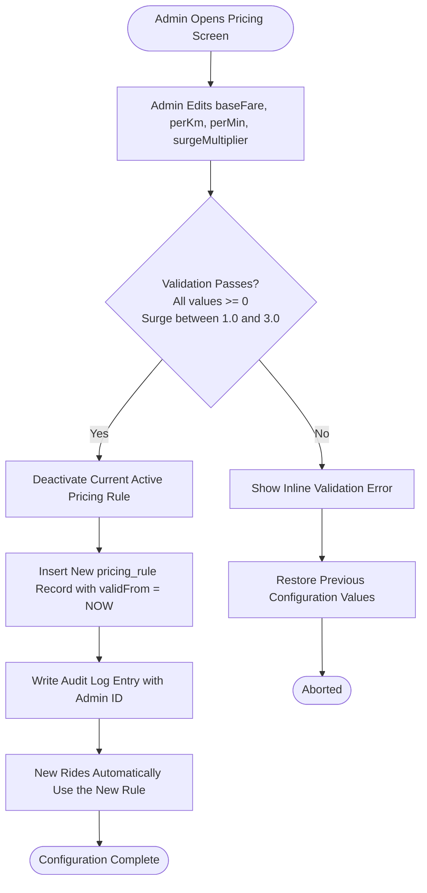

# ViaMe — Intelligent Multi-Role Urban Transport & Taxi Booking System

[](https://www.oracle.com/java/)
[](https://openjfx.io/)
[](https://www.mysql.com/)
[](https://saintjeaningenieur.org/)

**ViaMe** is an enterprise-grade, multi-role desktop simulation of an urban taxi and ride dispatching platform developed for **Institut Saint Jean (ISJ)**, Academic Year 2026/2027 (Course: Java Programming II, Lecturer: Engr Tanwi Nkiamboh).

---

## 👥 Engineering Team & Task Allocation Matrix (Group of 4)

| Role & Focus | Assigned Student | Current Status & Core Deliverables | Next Actions To Complete |
| :--- | :--- | :--- | :--- |
| **Student 1: System Analyst & Database Engineer** | *Team Member 1* | **Completed:** 10 Use Case specifications, Conceptual ERD, 3NF Normalization justification, and runnable `database/schema.sql` with triggers & seed data. | • Set up local MySQL 8.0 database.<br>• Execute `database/schema.sql` and verify indexes.<br>• Prepare database defense questions (1NF $\to$ 3NF proof). |
| **Student 2: Software Architect & Backend Core Engineer** | *Team Member 2* | **Completed:** 5-tier layered architecture design, `pom.xml`, OOP domain models (`User`, `Passenger`, `Driver`, `Trip`, etc.), DAO layer (`TripDAOImpl`) with ACID transactions and pessimistic locking. | • Implement remaining DAOs (`UserDAOImpl`, `PaymentDAOImpl`, `VehicleDAOImpl`).<br>• Implement `FareCalculationService` (Surge strategy) and `AuthenticationService`. |
| **Student 3: UI/UX & JavaFX Application Developer** | *Team Member 3* | **Ready to begin:** Screen flow specifications and JavaFX architecture mapped in `VIAME_PROJECT_SPECIFICATION.md`. | • Open Scene Builder and create FXML files in `src/main/resources/com/viame/views/`: `LoginView.fxml`, `PassengerDashboard.fxml`, `DriverDashboard.fxml`, `AdminConsole.fxml`.<br>• Bind UI elements to JavaFX Controllers. |
| **Student 4: QA, Security & Deployment Engineer** | *Team Member 4* | **Ready to begin:** JUnit test organization and 5 BI reports specified in `VIAME_PROJECT_SPECIFICATION.md`. | • Implement unit tests under `src/test/java/` (`PassengerTest`, `TripTest`, `PasswordHasherTest`).<br>• Implement JasperReports or JavaFX Chart export for the 5 BI reports.<br>• Prepare oral defense slides. |

---

## 🏛️ System Architecture

ViaMe implements a strictly decoupled **5-Tier Layered Architecture**:



---

## 📊 Live UML Diagrams (Rendered Directly in GitHub)

All source `.puml` files are archived in [`docs/uml/`](docs/uml/). The diagrams below render natively on GitHub:

### 1. Conceptual Entity-Relationship Diagram (ERD — 3NF)
*Source:* [`docs/uml/ViaMe_ERD.puml`](docs/uml/ViaMe_ERD.puml)

```mermaid
erDiagram
    USER ||--o| PASSENGER_PROFILE : "is a passenger"
    USER ||--o| DRIVER_PROFILE : "is a driver"
    USER ||--o{ SESSION : "authenticates"
    USER ||--o{ AUDIT_LOG : "generates"

    DRIVER_PROFILE ||--o{ VEHICLE : "owns"
    PASSENGER_PROFILE ||--o{ RIDE : "requests"
    DRIVER_PROFILE ||--o{ RIDE : "serves"
    VEHICLE ||--o{ RIDE : "used for"
    PRICING_RULE ||--o{ RIDE : "computes fare"

    RIDE ||--|| FARE : "has one"
    RIDE ||--o| PAYMENT : "settled by"
    RIDE ||--o{ RATING : "receives"

    USER {
        bigint id PK
        string email UK
        string phone UK
        string password_hash
        enum role
        enum status
    }

    PASSENGER_PROFILE {
        bigint user_id PK_FK
        string full_name
        decimal wallet_balance
    }

    DRIVER_PROFILE {
        bigint user_id PK_FK
        string full_name
        string licence_number UK
        enum verification_status
        decimal rating_avg
        enum availability
    }

    VEHICLE {
        bigint id PK
        bigint driver_id FK
        string plate_number UK
        string make
        string model
        int seats
    }

    RIDE {
        bigint id PK
        bigint passenger_id FK
        bigint driver_id FK
        string pickup_address
        string dropoff_address
        decimal distance_km
        enum status
        int version
    }

    FARE {
        bigint id PK
        bigint ride_id FK_UK
        decimal base_fare
        decimal distance_component
        decimal time_component
        decimal surge_multiplier
        decimal total_amount
    }

    PAYMENT {
        bigint id PK
        bigint ride_id FK
        decimal amount
        enum method
        enum status
        string transaction_ref UK
    }

    PRICING_RULE {
        bigint id PK
        string name
        decimal base_fare
        decimal per_km
        decimal surge_multiplier
        boolean active
    }
```

---

### 2. Ride Lifecycle State Machine
*Source:* [`docs/uml/ViaMe_StateRide.puml`](docs/uml/ViaMe_StateRide.puml)



---

### 3. Driver Onboarding Activity Workflow (AD-2)
*Source:* [`docs/uml/ViaMe_AD2_Onboarding.puml`](docs/uml/ViaMe_AD2_Onboarding.puml)



---

### 4. Admin Dynamic Pricing Rule Configuration (AD-3)
*Source:* [`docs/uml/ViaMe_AD3_Pricing.puml`](docs/uml/ViaMe_AD3_Pricing.puml)



---

## 🚀 Getting Started & Database Setup

1. **Clone the repository:**
   ```bash
   git clone https://github.com/emmanueloyono-debug/ViaMe.git
   cd ViaMe
   ```

2. **Initialize the MySQL Database:**
   ```bash
   mysql -u root -p < database/schema.sql
   ```

3. **Build the Application:**
   ```bash
   mvn clean compile
   ```

4. **Launch the JavaFX Multi-Role Simulation:**
   ```bash
   mvn javafx:run
   ```

For complete technical specifications, 10 use case flows, and defense Q&A, refer to **[VIAME_PROJECT_SPECIFICATION.md](VIAME_PROJECT_SPECIFICATION.md)**.
