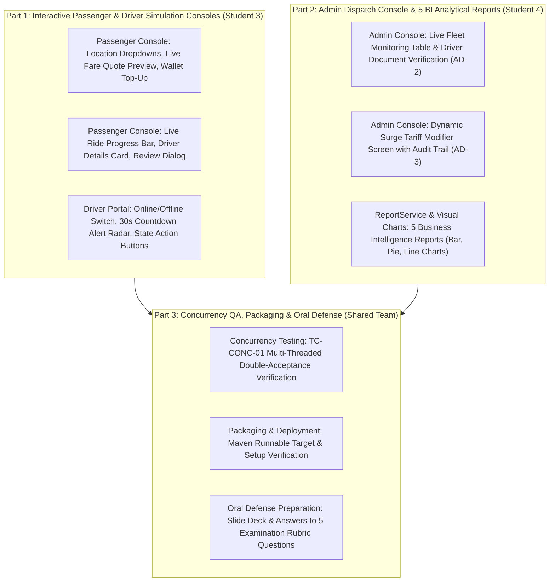
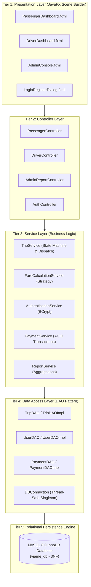
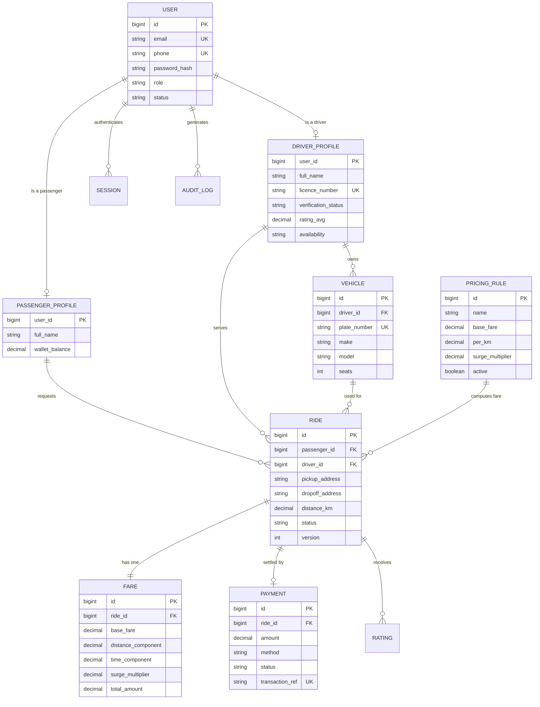
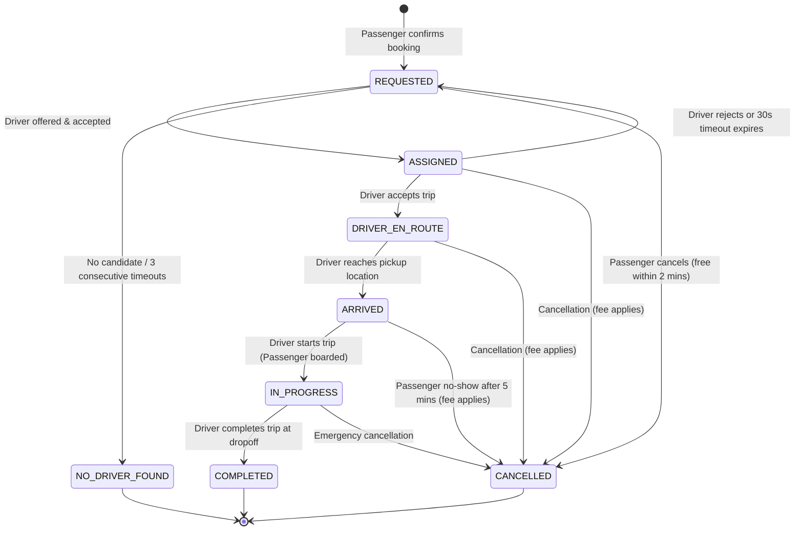
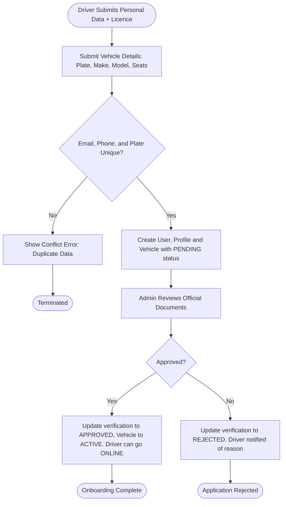
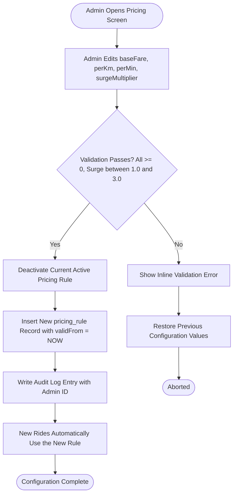

# ViaMe — Intelligent Multi-Role Urban Transport & Taxi Booking System

[](https://www.oracle.com/java/)
[](https://openjfx.io/)
[](https://www.mysql.com/)
[](https://saintjeaningenieur.org/)

**ViaMe** is an enterprise-grade, multi-role desktop simulation of an urban taxi and ride dispatching platform developed for **Institut Saint Jean (ISJ)**, Academic Year 2026/2027 (Course: Java Programming II, Lecturer: Engr Tanwi Nkiamboh).

---

## 👥 Engineering Team & Task Allocation Matrix (Group of 4)

> **Current System Status:** **~75% Overall Completion** achieved through Sprints 1 & 2.  
> **Student 2 (Software Architect & Backend Core Engineer)** has delivered the entire 5-tier backend foundation, all 11 DAOs, 8 business services, security infrastructure, JavaFX `MainApp` launcher, authentication views, and 25 passing unit tests.

| Role & Focus | Assigned Student | Current Status & Core Deliverables | Next Actions To Complete |
| :--- | :--- | :--- | :--- |
| **Student 1: System Analyst & Database Engineer** | *Team Member 1* | **100% Completed:** 10 Use Case specifications, Conceptual ERD, 3NF Normalization justification, and runnable `database/schema.sql` with triggers & verified seed data. | • Maintain local MySQL 8.0 database instance.<br>• Defend 3NF Normalization proofs and trigger logic during oral defense. |
| **Student 2: Software Architect & Backend Core Engineer** | *Student 2 (Lead Engineer)* | **75% Completed (Sprints 1 & 2 Done):**<br>• Full 5-tier architecture & domain models (`User`, `Passenger`, `Driver`, `Trip`, `Fare`, `Payment`, etc.).<br>• Complete DAO Layer: `UserDAO`, `PassengerDAO`, `DriverDAO`, `VehicleDAO`, `TripDAO`, `PaymentDAO`, `PricingRuleDAO`, `FareDAO`, `RatingDAO`, `AuditLogDAO`, and `TransactionManager`.<br>• Full Service Layer: `AuthenticationService` (BCrypt), `TripService` (pessimistic locking & state machine), `FareCalculationService` (dynamic surge strategy), `DriverMatchingService` (Haversine), `PaymentService` (ACID wallet & cash settlement), `RatingService`, `CancellationPolicy`.<br>• Application Shell: `MainApp.java`, `styles.css`, `LoginView.fxml`, `RegisterView.fxml`, and 25 passing unit tests. | • Assist team with backend service integration in JavaFX views.<br>• Code-review BI analytical SQL aggregate queries. |
| **Student 3: UI/UX & JavaFX Simulation Developer** | *Team Member 3* | **Ready for Sprint 3 (Part 1 of Remaining Work):** FXML layout shells and controller classes created. | **Execute Part 1 (Sprint 3):**<br>• Implement interactive ride booking on `PassengerDashboard.fxml` (location pickers, instant fare quote preview, wallet top-up, trip tracker).<br>• Implement interactive driver radar on `DriverDashboard.fxml` (duty toggle, 30s countdown broadcast alert, ride workflow action buttons). |
| **Student 4: QA, Security & Deployment Engineer** | *Team Member 4* | **Ready for Sprint 4 & 5 (Parts 2 & 3 of Remaining Work):** BCrypt authentication & base unit test suite established. | **Execute Parts 2 & 3 (Sprints 4 & 5):**<br>• Implement `ReportService` & embed 5 Business Intelligence analytical charts (`BarChart`, `PieChart`, `LineChart`) in `AdminConsole.fxml`.<br>• Implement driver verification (`AD-2`) and pricing rule configurator (`AD-3`).<br>• Execute multi-threaded concurrency test (`TC-CONC-01`) and prepare oral defense presentation deck. |

---

## 📌 Division of Remaining Work (The Final 25% in 3 Parts)

The remaining 25% of the project scope is divided into 3 actionable, independent modules:



1. **Part 1 — Interactive Passenger & Driver Consoles (`Sprint 3`):**
   - Connect `PassengerDashboardController` to `FareCalculationService`, `TripService`, and `PaymentService`.
   - Douala hotspot location pickers (Akwa, Bonamoussadi, Bonanjo, Makepe, Airport, etc.) with real-time distance and fare calculations.
   - Live simulated ride progress bar (`REQUESTED` $\to$ `ASSIGNED` $\to$ `DRIVER_EN_ROUTE` $\to$ `ARRIVED` $\to$ `IN_PROGRESS` $\to$ `COMPLETED`).
   - Driver proximity radar alert with 30-second countdown timer and sequential trip execution buttons.
   - Digital wallet balance top-up modal and post-trip star rating feedback dialog.

2. **Part 2 — Admin Dispatch Console & 5 BI Reports (`Sprint 4`):**
   - Implement `ReportService` with analytical aggregate SQL queries for the 5 BI reports required by Section 7 of the specification.
   - Embed interactive JavaFX `BarChart`, `PieChart`, and `LineChart` into `AdminConsole.fxml`.
   - Driver onboarding document verification table (`AD-2` workflow: Approve / Reject).
   - Dynamic Tariff & Surge rate modifier form (`AD-3` workflow: base fare, per-km, per-min, surge 1.0x–3.0x).

3. **Part 3 — Quality Assurance, Packaging & Oral Defense (`Sprint 5`):**
   - Execute multi-threaded concurrency race condition test (`TC-CONC-01`) verifying MySQL row locking (`SELECT ... FOR UPDATE`).
   - Validate full clean build and run via `mvn javafx:run`.
   - Prepare oral defense slide deck and rehearse answers to the 5 grading rubric questions (OOP tenets, pessimistic locking, SQL injection neutralization, database fault tolerance, and 3NF normalization proof).

---

## 💻 Platform Scope: Desktop vs. Mobile Clarification

> [!IMPORTANT]
> **ViaMe is strictly an Enterprise Desktop Application (Desktop Simulation Suite).**  
> It is **not** a mobile app (no Android APK or iOS app).
> 
> - **Technology:** Built with **Java 17+ and JavaFX 17+ using Scene Builder FXML**, executing directly on the desktop JVM (Windows, macOS, Linux).
> - **Simulation Paradigm:** Designed specifically to satisfy the Institut Saint Jean (ISJ) academic requirements by simulating a real-world multi-user transport network on a single workstation.
> - **Concurrent Multi-Window Simulation:** Users can launch the **Passenger Console**, the **Driver Portal**, and the **Admin Dispatch Console** as separate, concurrent windows side-by-side, witnessing instant state synchronization and transactional locking in real time.

---

## 🌟 Comprehensive Feature Matrix: What ViaMe Can Do

Below is the exhaustive, structured inventory of all system features:

### 1. Security, Identity & Role-Based Access Control (RBAC)
- **Multi-Role Authentication:** Dedicated login and workflows for Passengers, Drivers, and Administrators.
- **BCrypt Password Cryptography:** Passwords hashed using adaptive BCrypt (cost factor 12) with unique salt generation; plaintext passwords are never stored.
- **Role Routing:** Automatic workspace routing upon sign-in based on user role (`UserRole.PASSENGER`, `UserRole.DRIVER`, `UserRole.ADMIN`).
- **Demo Quick-Fill Chips:** One-click credentials autofill on the sign-in screen for defense examiners (`Passenger (Alice)`, `Driver (Samuel)`, `Admin Console`).
- **Account Moderation:** Account status lifecycle enforcement (`ACTIVE`, `PENDING`, `SUSPENDED`).
- **Audit Logging:** Append-only security and regulatory event logging (`audit_log`) for all sensitive operations.

### 2. Passenger Experience & Ride Booking
- **Instant Pre-Booking Fare Estimation:** Computes Euclidean and road distance using the Haversine formula + urban road curvature factor (1.3x).
- **Dynamic Tariff Pricing Engine:** Transparent breakdown displaying Base Fare, Distance Charge, Time Charge, Surge Multiplier, and Total XAF.
- **Flexible Payment Methods:** Choice between in-app Digital Wallet balance and Direct Cash payment.
- **Digital Wallet Management:** In-app balance tracking with atomic debit/credit operations, overdraft prevention, and simulated wallet top-up (+500 XAF minimum).
- **Geospatial Proximity Dispatch:** Broadcasts trip requests to approved, online drivers within a 5 km radius (expanding to 10 km if needed).
- **Real-Time Ride Tracker:** Live visual progress bar synchronizing ride lifecycle states (`REQUESTED` $\to$ `COMPLETED`).
- **Assigned Driver Profile Card:** Live display of assigned driver name, phone number, vehicle plate, make/model, and reputation rating.
- **Fair Cancellation Window:** 2-minute free cancellation window for passengers; applies base-fare fee if cancelled after 2 minutes.
- **Two-Way Rating & Review:** Post-trip 1-to-5 star evaluation with feedback comments; automatically updates driver rating via database trigger.
- **Personal Ride History:** Complete historical ledger of past rides, timestamps, routes, fares, and payment receipts.

### 3. Driver Portal & Ride Execution
- **Driver Onboarding Workflow (AD-2):** Driver registration capturing driver licence number, vehicle plate, make, model, and passenger seat capacity (starts in `PENDING` status).
- **Duty Status Toggle:** Real-time switch between `ONLINE` and `OFFLINE`.
- **GPS Coordinates Simulation:** Dynamic update of driver latitude/longitude coordinates.
- **Ride Broadcast Radar:** Incoming trip broadcast alert with distance to pickup, estimated fare, and 30-second countdown response timer.
- **Pessimistic Concurrency Lock (AD-1):** MySQL `SELECT ... FOR UPDATE` prevents race conditions; only the first driver to click "Accept" claims the ride.
- **Sequential Ride Progression:** One-click state transition workflow:
  $$\text{Accept Trip} \longrightarrow \text{En Route} \longrightarrow \text{Arrived at Pickup} \longrightarrow \text{Start Ride} \longrightarrow \text{Complete Ride}$$
- **Passenger No-Show Protection:** Driver can cancel after 5 minutes waiting at pickup, billing a no-show cancellation fee.
- **Earnings & Commission Counter:** Automated payout ledger tracking gross revenue, 20% platform commission deduction, and 80% driver net earnings.
- **Reputation Score:** Live display of average star rating recalculated automatically by MySQL trigger `trg_after_rating_insert`.

### 4. Dispatcher & Administrator Console
- **Live Fleet Monitoring:** Real-time visibility into all active trips, driver locations, and duty statuses across the city.
- **Driver Verification Management (AD-2):** Review pending driver licence documents and vehicle inspection details with one-click **Approve** or **Reject** actions.
- **Dynamic Tariff & Surge Pricing Configurator (AD-3):** Modify Base Fare, Per-Km rate, Per-Minute rate, and Surge Multipliers (1.0x to 3.0x) with versioned audit trail.
- **User Moderation:** Suspend or reactivate user accounts violating platform terms.
- **5 Business Intelligence (BI) Analytical Reports:**
  1. *Daily Revenue & Commission Ledger:* Gross turnover, 20% company revenue, and 80% driver payouts.
  2. *Driver Performance Matrix:* Completed rides, cancellation rates, acceptance rates, and average ratings.
  3. *Peak Demand & High-Demand Route Heatmap:* Hourly booking volume (0–23h) and surge spike areas.
  4. *Trip Cancellation & Attrition Analysis:* Passenger vs. driver cancellations, average wait times, and lost revenue.
  5. *Customer Loyalty Segmentation:* Completed rides, total expenditure, wallet vs. cash adoption, and customer loyalty tiers (Gold/Silver/Bronze).
- **Interactive Visual Charts:** Analytical data visualization using JavaFX `BarChart`, `PieChart`, and `LineChart` with CSV file export.

### 5. Architectural, Database & Security Excellence
- **5-Tier Layered Decoupling:** Complete separation of concerns:
  $$\text{Presentation (FXML)} \longleftrightarrow \text{Controllers} \longleftrightarrow \text{Services} \longleftrightarrow \text{DAOs} \longleftrightarrow \text{MySQL 8.0}$$
- **100% Parameterized Queries:** Zero SQL string concatenation across all DAOs, completely eliminating SQL Injection vulnerabilities.
- **ACID Transaction Atomicity:** Multi-step business processes (e.g., wallet debit + driver credit + trip status transition) wrapped in single transactions with automated rollback on failure.
- **Dual Concurrency Controls:**
  - *Optimistic Locking:* `version` integer column on `ride` prevents lost updates during status transitions.
  - *Pessimistic Locking:* `FOR UPDATE` prevents double-dispatching when multiple drivers accept a ride concurrently.
- **3NF Relational Integrity:** Normalized MySQL schema with foreign key cascades, check constraints, indexes, and triggers.

---

## 🏛️ System Architecture

ViaMe implements a strictly decoupled **5-Tier Layered Architecture**:



---

## 📊 Live UML Diagrams (Rendered Directly in GitHub)

All source `.puml` files are archived in [`docs/uml/`](docs/uml/). The diagrams below render natively on GitHub:

### 1. Conceptual Entity-Relationship Diagram (ERD — 3NF)
*Source:* [`docs/uml/ViaMe_ERD.puml`](docs/uml/ViaMe_ERD.puml)



---

### 2. Ride Lifecycle State Machine
*Source:* [`docs/uml/ViaMe_StateRide.puml`](docs/uml/ViaMe_StateRide.puml)



---

### 3. Driver Onboarding Activity Workflow (AD-2)
*Source:* [`docs/uml/ViaMe_AD2_Onboarding.puml`](docs/uml/ViaMe_AD2_Onboarding.puml)



---

### 4. Admin Dynamic Pricing Rule Configuration (AD-3)
*Source:* [`docs/uml/ViaMe_AD3_Pricing.puml`](docs/uml/ViaMe_AD3_Pricing.puml)



---

## 🚀 Getting Started & Database Setup

1. **Clone the repository:**
   ```bash
   git clone https://github.com/emmanueloyono-debug/ViaMe.git
   cd ViaMe
   ```

2. **Initialize the MySQL Database:**
   ```bash
   mysql -u root -p < database/schema.sql
   ```

3. **Build the Application:**
   ```bash
   mvn clean compile
   ```

4. **Launch the JavaFX Multi-Role Simulation:**
   ```bash
   mvn javafx:run
   ```

For complete technical specifications, 10 use case flows, and defense Q&A, refer to **[VIAME_PROJECT_SPECIFICATION.md](VIAME_PROJECT_SPECIFICATION.md)**.
