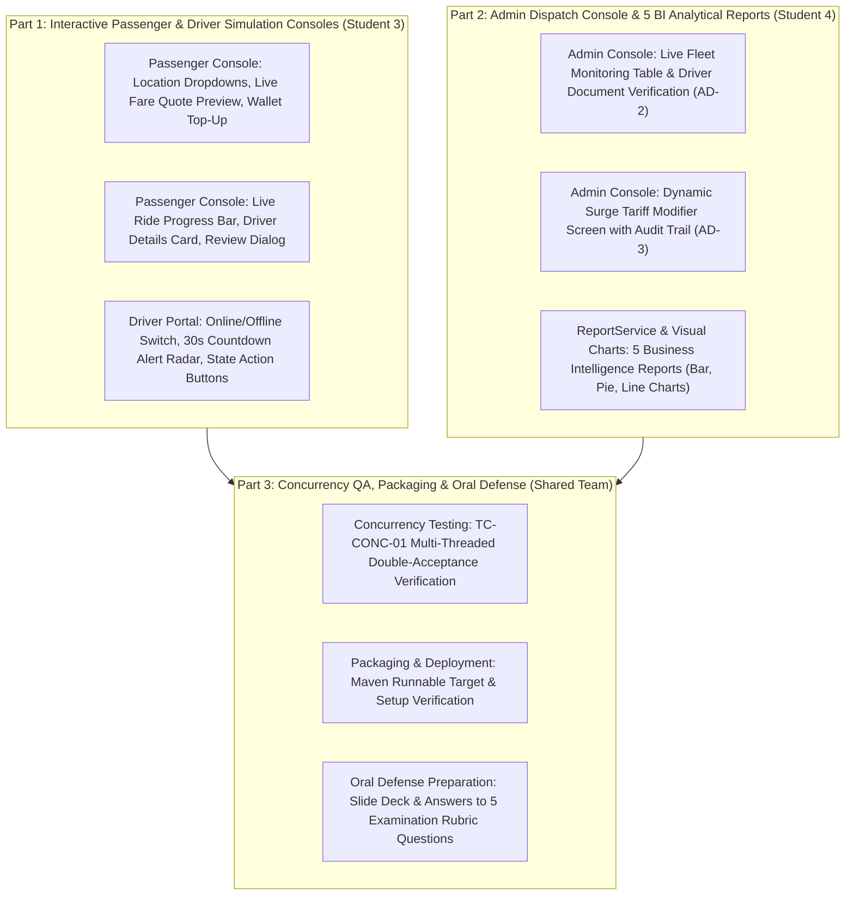
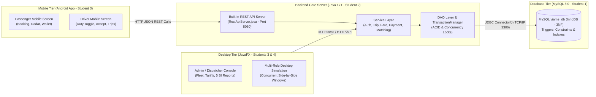
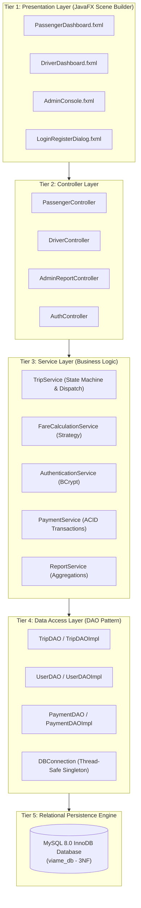
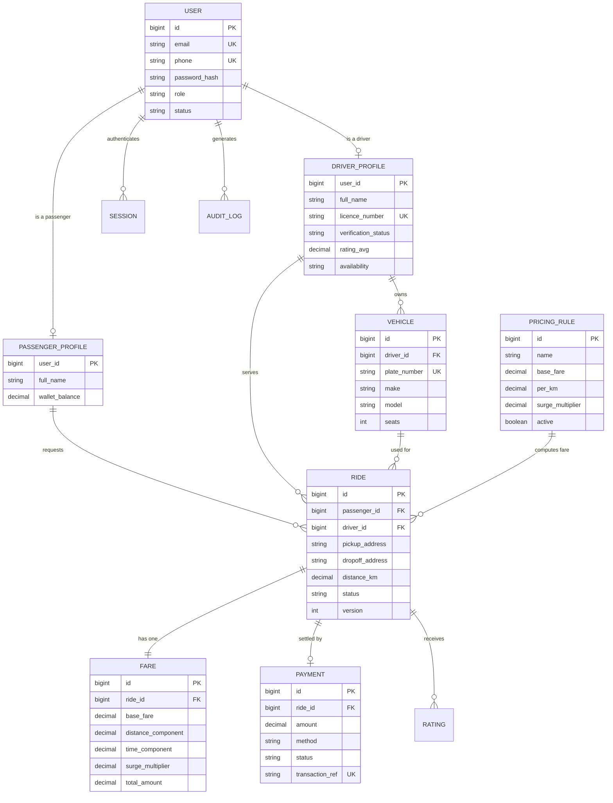
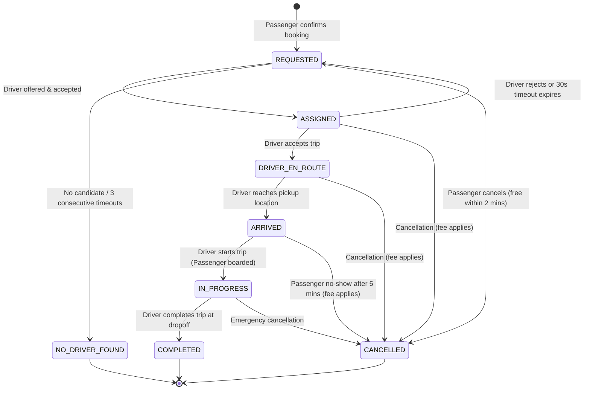
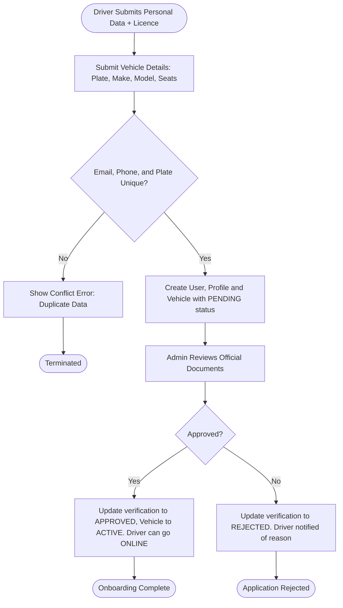
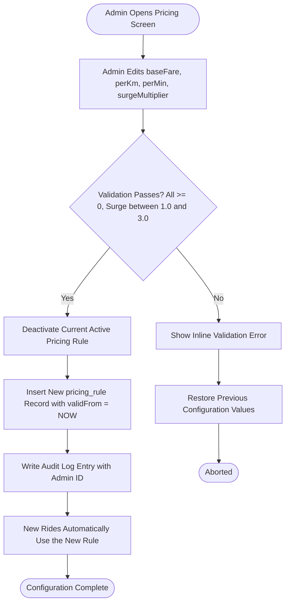

# ViaMe — Intelligent Multi-Role Urban Transport & Taxi Booking System

[](https://www.oracle.com/java/)
[](https://openjfx.io/)
[](https://www.mysql.com/)
[](https://saintjeaningenieur.org/)

**ViaMe** is an enterprise-grade, multi-role desktop simulation of an urban taxi and ride dispatching platform developed for **Institut Saint Jean (ISJ)**, Academic Year 2026/2027 (Course: Java Programming II, Lecturer: Engr Tanwi Nkiamboh).

---

## 👥 Engineering Team & Task Allocation Matrix (Group of 4)

> **Current System Status:** **Backend & Database 100% Complete (~75% Overall Completion)** — Ready for UI & Mobile Wiring.  
> **Student 2 (Software Architect & Backend Core Engineer)** has delivered the entire 5-tier backend foundation, all 12 DAOs (including `SessionDAO`), 10 business services (including `AdminService` & `ReportService`), multi-window session isolation, **`RestApiServer` with 23 REST endpoints secured by Bearer tokens & RBAC**, **152 passing tests across 39 test classes** (including `TC-CONC-01` & live `MobileDesktopBackendBridgeTest`), portable desktop/API launchers, and JavaFX authentication views.

| Role & Focus | Assigned Student | Current Status & Core Deliverables | Next Actions & Implementation Guide |
| :--- | :--- | :--- | :--- |
| **Student 1: System Analyst & Database Engineer** | **SIMEN** | **100% Completed & Merged into `main`:** 10 Use Case specifications, Physical Relational ERD, 3NF Normalization justification (`docs/3NF_NORMALIZATION_JUSTIFICATION.md`), and verified runnable `database/schema.sql` with bounded rating trigger, indexed `session` table & expanded Douala seed data. | • Maintain local MySQL 8.0 database instance.<br>• Defend 3NF Normalization proofs and trigger logic during oral defense.<br>👉 **[Simen's Implementation Guide](docs/tasks/STUDENT_1_SIMEN_DATABASE_GUIDE.md)** |
| **Student 2: Software Architect & Backend Core Engineer** | **Emmanuel Oyono** *(Project Lead & Architecture Reviewer)* | **100% Completed (Backend Core, REST Mobile Backend & DB Verified):**<br>• Full 5-tier architecture & domain models (`User`, `Passenger`, `Driver`, `Trip`, `Fare`, `Payment`, `Session`, `ReportRows`, etc.).<br>• Complete DAO Layer (12 DAOs + `TransactionManager`): `UserDAO`, `PassengerDAO`, `DriverDAO`, `VehicleDAO`, `TripDAO`, `PaymentDAO`, `PricingRuleDAO`, `FareDAO`, `RatingDAO`, `AuditLogDAO`, `ReportDAO`, `SessionDAO`.<br>• Full Service Layer (10 Services): `AuthenticationService` (BCrypt), `TripService` (pessimistic locking & state machine), `FareCalculationService` (dynamic surge strategy), `DriverMatchingService` (Haversine), `PaymentService` (ACID wallet & cash settlement), `RatingService`, `CancellationPolicy`, `ReportService` (5 BI reports + RFC-4180 CSV export), `AdminService` (`AD-2` onboarding & `AD-3` tariff management).<br>• **REST API Server (`RestApiServer.java`):** 23 HTTP REST endpoints with Bearer token auth, RBAC, anti-ID spoofing, `Locale.US` JSON formatting, and enriched mobile driver/fare payloads.<br>• **Full Test Suite:** **152 tests across 39 test classes** passing with 0 failures/errors/skips, including `TC-CONC-01` concurrency and live `MobileDesktopBackendBridgeTest`.<br>• **Desktop Shell & Launchers:** `MainApp.java` (multi-window session context), `styles.css`, `LoginView.fxml`, `RegisterView.fxml`, `run-desktop.bat/.ps1`, `run-api.bat/.ps1`. | • Code review and test verification of collaborator Pull Requests.<br>• Authorize all merges into `main`.<br>• Support Daniella & Delma with mobile REST and JavaFX service integration. |
| **Student 3: UI/UX & Mobile / Desktop Application Developer** | **DANIELLA** | **Ready for Sprint 3 (Part 1 of Remaining Work):** Desktop FXML layout shells (`setPassenger`/`setDriver` context hooks) ready; REST API mobile backend & CORS/Bearer auth live (`run-api.bat`). | **Execute Part 1 (Sprint 3):**<br>• Build hybrid mobile client (`mobile/` Vite + React + Leaflet PWA + Capacitor Android APK) consuming `RestApiServer` with `Authorization: Bearer <token>`.<br>• Wire interactive JavaFX Passenger and Driver dashboards (`PassengerDashboardController`, `DriverDashboardController`) to backend services.<br>👉 **[Daniella's Implementation Guide](docs/tasks/STUDENT_3_DANIELLA_MOBILE_UI_GUIDE.md)**<br>📱 **[Hybrid Mobile Guide (PWA + Android APK, Leaflet maps)](docs/tasks/STUDENT_3_DANIELLA_HYBRID_MOBILE_GUIDE.md)** |
| **Student 4: QA, Security & Deployment Engineer** | **DELMA** | **Ready for Sprints 4 & 5 (Parts 2 & 3 of Remaining Work):** Backend `AdminService`, `ReportService`, and `TC-CONC-01` concurrency harness ready. | **Execute Parts 2 & 3 (Sprints 4 & 5):**<br>• Embed visual charts (`BarChart`, `PieChart`, `LineChart`) into `AdminConsole.fxml` wired to `ReportService`.<br>• Wire fleet monitoring, driver verification (`AD-2`), and pricing rule configurator (`AD-3`) in `AdminDashboardController` via `AdminService`.<br>• Configure fat-JAR packaging & prepare oral defense presentation slide deck.<br>👉 **[Delma's Implementation Guide](docs/tasks/STUDENT_4_DELMA_QA_ADMIN_GUIDE.md)** |

> [!IMPORTANT]
> ### 🛡️ Repository Merge & Branch Governance Protocol
> 1. **Protected Branch:** The `main` branch is strictly protected. Direct pushes to `main` are prohibited for all team members.
> 2. **Feature Branch Convention:** Collaborators work exclusively on designated branches (`feature/simen-database-analysis`, `feature/daniella-mobile-ui`, `feature/delma-qa-admin`).
> 3. **Verification Before Merge:** When a feature branch is ready, a Pull Request (PR) must be submitted targeting `main`. **Emmanuel Oyono** executes full automated test suites, architectural audits, and regression checks with Antigravity.
> 4. **Merge Authorization:** Only Emmanuel Oyono possesses merge authority for the `main` branch. Unverified or conflicting code will be rejected with actionable feedback.

---

## 📌 Division of Remaining Work (The Final 25% in 3 Parts)

The remaining 25% of the project scope is divided into 3 actionable, independent modules:



1. **Part 1 — Interactive Passenger & Driver Consoles (`Sprint 3`):**
   - Connect `PassengerDashboardController` to `FareCalculationService`, `TripService`, and `PaymentService`.
   - Douala hotspot location pickers (Akwa, Bonamoussadi, Bonanjo, Makepe, Airport, etc.) with real-time distance and fare calculations.
   - Live simulated ride progress bar (`REQUESTED` $\to$ `ASSIGNED` $\to$ `DRIVER_EN_ROUTE` $\to$ `ARRIVED` $\to$ `IN_PROGRESS` $\to$ `COMPLETED`).
   - Driver proximity radar alert with 30-second countdown timer and sequential trip execution buttons.
   - Digital wallet balance top-up modal and post-trip star rating feedback dialog.

2. **Part 2 — Admin Dispatch Console & 5 BI Reports (`Sprint 4`):**
   - Implement `ReportService` with analytical aggregate SQL queries for the 5 BI reports required by Section 7 of the specification.
   - Embed interactive JavaFX `BarChart`, `PieChart`, and `LineChart` into `AdminConsole.fxml`.
   - Driver onboarding document verification table (`AD-2` workflow: Approve / Reject).
   - Dynamic Tariff & Surge rate modifier form (`AD-3` workflow: base fare, per-km, per-min, surge 1.0x–3.0x).

3. **Part 3 — Quality Assurance, Packaging & Oral Defense (`Sprint 5`):**
   - Execute multi-threaded concurrency race condition test (`TC-CONC-01`) verifying MySQL row locking (`SELECT ... FOR UPDATE`).
   - Validate full clean build and run via `mvn javafx:run`.
   - Prepare oral defense slide deck and rehearse answers to the 5 grading rubric questions (OOP tenets, pessimistic locking, SQL injection neutralization, database fault tolerance, and 3NF normalization proof).

---

## 📱💻 Platform Scope: Mobile (Android) + Desktop (JavaFX) Architecture

> [!IMPORTANT]
> **Project 5 Specification: Android Taxi/Transport Booking System**  
> **Mandatory Rule:** *"The Android app must not connect directly to MySQL. Use Android → REST API → Java backend → MySQL."*

ViaMe fulfills this requirement with a **Distributed Multi-Tier Hybrid Architecture**:



1. **Android Mobile Client (Student 3):**
   - For **Passengers** and **Drivers** on mobile devices.
   - Communicates exclusively via HTTP REST API (`/api/auth/*`, `/api/fare/*`, `/api/trips/*`, `/api/wallet/*`).
   - Does **not** have any direct JDBC connection or MySQL drivers, preserving zero-trust security.
2. **Java REST API & Backend Server (Student 2):**
   - Central business logic host: BCrypt authentication, fare strategy, dispatch matching, and ACID transactions.
   - Built-in lightweight [`RestApiServer.java`](src/main/java/com/viame/api/RestApiServer.java) running on port `8080` without external dependency bloat.
   - **REST API Endpoints Specification** (*🔒 = requires `Authorization: Bearer <token>` from `/api/auth/login`*):

     | Category | Method & Path | Auth | Query / Body Parameters | Response Description |
     | :--- | :--- | :---: | :--- | :--- |
     | **System** | `GET /api/health` | Public | None | System status and service health check (`{"status":"UP"}`) |
     | **Avatar** | `GET /api/avatar` | Public | `?seed=&mood=&size=&shape=&animated=` | Offline native Mimo SVG avatar |
     | **Auth** | `POST /api/auth/login` | Public | `{"email": "...", "password": "..."}` | Bearer `token`, `userId`, `role`, `status`, `avatarUrl`, `expiresAt` |
     | **Auth** | `POST /api/auth/logout` | Optional 🔒 | `{}` | Revokes the active session token from `session` table |
     | **Auth** | `POST /api/auth/register/passenger` | Public | `{"email": "...", "password": "...", "phone": "...", "fullName": "...", "paymentMethod": "WALLET"}` | Registered passenger ID and initial wallet |
     | **Auth** | `POST /api/auth/register/driver` | Public | `{"email": "...", "password": "...", "phone": "...", "fullName": "...", "licenceNumber": "...", "plateNumber": "...", "make": "...", "model": "...", "seats": 4}` | Registered driver ID with `PENDING` verification status |
     | **Fare** | `POST /api/fare/estimate` | Public | `{"pickupLat": 4.05, "pickupLng": 9.76, "dropoffLat": 4.07, "dropoffLng": 9.71}` | Distance (km), duration (min), surge multiplier, estimated fare (`totalAmount`) |
     | **Dispatch** | `GET /api/drivers/available` | Public | `?lat=4.05&lng=9.76&radius=5.0` | List of nearby online drivers with distance, rating, and avatar URL |
     | **Driver** | `GET/POST /api/drivers/availability` | 🔒 | `?driverId=` or `{"driverId": 2, "status": "ONLINE", "lat": ..., "lng": ...}` | Gets or updates `ONLINE`/`OFFLINE` duty status (and optional GPS coordinates) |
     | **Driver** | `POST /api/drivers/location` | 🔒 | `{"driverId": 2, "lat": 4.051, "lng": 9.768}` | Updates driver GPS coordinates in `driver_profile` |
     | **Driver** | `GET /api/drivers/earnings` | 🔒 | `?driverId=2` | Gross revenue, 20% commission, 80% net earnings, completed trips, rating |
     | **Trips** | `POST /api/trips/request` | 🔒 | `{"passengerId": 4, "pickupLat": ..., "dropoffLat": ..., "paymentMethod": "WALLET"}` | Created trip record with `REQUESTED` status (`402` if insufficient wallet funds) |
     | **Trips** | `GET /api/trips/pending` | 🔒 | None | Pending `REQUESTED` rides with coordinates, distance, and fare (`totalAmount`) |
     | **Trips** | `POST /api/trips/accept` | 🔒 | `{"tripId": 10, "driverId": 2}` | Pessimistic locking assignment (`200 OK` or `400` if already taken) |
     | **Trips** | `GET /api/trips/status` (or `/get`) | 🔒 | `?tripId=` or `?passengerId=` or `?driverId=` | Enriched trip state + fare breakdown + assigned driver & vehicle details |
     | **Trips** | `POST /api/trips/status` | 🔒 | `{"tripId": 10, "driverId": 2, "action": "EN_ROUTE\|ARRIVED\|START\|COMPLETE", "paymentMethod": "WALLET"}` | Advances trip state machine and settles payment on `COMPLETE` |
     | **Trips** | `POST /api/trips/cancel` | 🔒 | `{"tripId": 10, "userId": 4, "isPassenger": true}` | Cancels trip with grace period fee logic |
     | **Wallet** | `GET /api/wallet/balance` | 🔒 | `?passengerId=4` | Current passenger wallet balance |
     | **Wallet** | `POST /api/wallet/topup` | 🔒 | `{"passengerId": 4, "amount": 5000.00, "provider": "MOBILE_MONEY"}` | Updated wallet balance after atomic transaction |
     | **Ratings** | `POST /api/ratings` / `GET /api/ratings` | 🔒 (POST) | `{"tripId": 10, "raterId": 4, "rateeId": 2, "score": 5, "comment": "..."}` / `?userId=` | Submits 1–5 star rating (triggers `rating_avg` recalc) or lists user ratings |
     | **BI Reports** | `GET /api/reports/revenue` | 🔒 Admin | `?from=YYYY-MM-DD&to=YYYY-MM-DD` | Daily gross revenue, 20% platform commission, 80% driver payout |
     | **BI Reports** | `GET /api/reports/drivers` | 🔒 Admin | `?from=YYYY-MM-DD&to=YYYY-MM-DD` | Trips completed, cancellations, completion rate %, ratings, gross |
     | **BI Reports** | `GET /api/reports/peak-hours` | 🔒 Admin | `?from=YYYY-MM-DD&to=YYYY-MM-DD` | Hourly demand histogram (0–23h), completion rate, avg surge |
     | **BI Reports** | `GET /api/reports/pickup-zones` | 🔒 Admin | `?from=YYYY-MM-DD&to=YYYY-MM-DD&limit=10` | Top high-demand pickup locations ranked by request volume |
     | **BI Reports** | `GET /api/reports/cancellations` | 🔒 Admin | `?from=YYYY-MM-DD&to=YYYY-MM-DD` | Breakdown by cancelling party, avg minutes to cancel, lost revenue |
     | **BI Reports** | `GET /api/reports/loyalty` | 🔒 Admin | `?from=YYYY-MM-DD&to=YYYY-MM-DD` | Customer lifetime spend, completed rides, wallet adoption %, tier (Gold/Silver/Bronze) |

3. **Desktop JavaFX Console (Students 3 & 4):**
   - For **Administrators & Dispatchers** to monitor the fleet in real time, verify driver documents (`AD-2`), update dynamic surge pricing tariffs (`AD-3`), and generate the **5 Business Intelligence Reports** with visual charts (`BarChart`, `PieChart`, `LineChart`).
   - Doubles as an in-class **Multi-Role Desktop Simulation** suite where examiners can test the Passenger, Driver, and Admin roles side by side on one PC.

---

## 🌟 Comprehensive Feature Matrix: What ViaMe Can Do

Below is the exhaustive, structured inventory of all system features:

### 1. Security, Identity & Role-Based Access Control (RBAC)
- **Multi-Role Authentication:** Dedicated login and workflows for Passengers, Drivers, and Administrators.
- **BCrypt Password Cryptography:** Passwords hashed using adaptive BCrypt (cost factor 12) with unique salt generation; plaintext passwords are never stored.
- **Role Routing:** Automatic workspace routing upon sign-in based on user role (`UserRole.PASSENGER`, `UserRole.DRIVER`, `UserRole.ADMIN`).
- **Demo Quick-Fill Chips:** One-click credentials autofill on the sign-in screen for defense examiners (`Passenger (Alice)`, `Driver (Samuel)`, `Admin Console`).
- **Account Moderation:** Account status lifecycle enforcement (`ACTIVE`, `PENDING`, `SUSPENDED`).
- **Audit Logging:** Append-only security and regulatory event logging (`audit_log`) for all sensitive operations.

### 2. Passenger Experience & Ride Booking
- **Instant Pre-Booking Fare Estimation:** Computes Euclidean and road distance using the Haversine formula + urban road curvature factor (1.3x).
- **Dynamic Tariff Pricing Engine:** Transparent breakdown displaying Base Fare, Distance Charge, Time Charge, Surge Multiplier, and Total XAF.
- **Flexible Payment Methods:** Choice between in-app Digital Wallet balance and Direct Cash payment.
- **Digital Wallet Management:** In-app balance tracking with atomic debit/credit operations, overdraft prevention, and simulated wallet top-up (+500 XAF minimum).
- **Geospatial Proximity Dispatch:** Broadcasts trip requests to approved, online drivers within a 5 km radius (expanding to 10 km if needed).
- **Real-Time Ride Tracker:** Live visual progress bar synchronizing ride lifecycle states (`REQUESTED` $\to$ `COMPLETED`).
- **Assigned Driver Profile Card:** Live display of assigned driver name, phone number, vehicle plate, make/model, and reputation rating.
- **Fair Cancellation Window:** 2-minute free cancellation window for passengers; applies base-fare fee if cancelled after 2 minutes.
- **Two-Way Rating & Review:** Post-trip 1-to-5 star evaluation with feedback comments; automatically updates driver rating via database trigger.
- **Personal Ride History:** Complete historical ledger of past rides, timestamps, routes, fares, and payment receipts.

### 3. Driver Portal & Ride Execution
- **Driver Onboarding Workflow (AD-2):** Driver registration capturing driver licence number, vehicle plate, make, model, and passenger seat capacity (starts in `PENDING` status).
- **Duty Status Toggle:** Real-time switch between `ONLINE` and `OFFLINE`.
- **GPS Coordinates Simulation:** Dynamic update of driver latitude/longitude coordinates.
- **Ride Broadcast Radar:** Incoming trip broadcast alert with distance to pickup, estimated fare, and 30-second countdown response timer.
- **Pessimistic Concurrency Lock (AD-1):** MySQL `SELECT ... FOR UPDATE` prevents race conditions; only the first driver to click "Accept" claims the ride.
- **Sequential Ride Progression:** One-click state transition workflow:
  $$\text{Accept Trip} \longrightarrow \text{En Route} \longrightarrow \text{Arrived at Pickup} \longrightarrow \text{Start Ride} \longrightarrow \text{Complete Ride}$$
- **Passenger No-Show Protection:** Driver can cancel after 5 minutes waiting at pickup, billing a no-show cancellation fee.
- **Earnings & Commission Counter:** Automated payout ledger tracking gross revenue, 20% platform commission deduction, and 80% driver net earnings.
- **Reputation Score:** Live display of average star rating recalculated automatically by MySQL trigger `trg_after_rating_insert`.

### 4. Dispatcher & Administrator Console
- **Live Fleet Monitoring:** Real-time visibility into all active trips, driver locations, and duty statuses across the city.
- **Driver Verification Management (AD-2):** Review pending driver licence documents and vehicle inspection details with one-click **Approve** or **Reject** actions.
- **Dynamic Tariff & Surge Pricing Configurator (AD-3):** Modify Base Fare, Per-Km rate, Per-Minute rate, and Surge Multipliers (1.0x to 3.0x) with versioned audit trail.
- **User Moderation:** Suspend or reactivate user accounts violating platform terms.
- **5 Business Intelligence (BI) Analytical Reports:**
  1. *Daily Revenue & Commission Ledger:* Gross turnover, 20% company revenue, and 80% driver payouts.
  2. *Driver Performance Matrix:* Completed rides, cancellation rates, acceptance rates, and average ratings.
  3. *Peak Demand & High-Demand Route Heatmap:* Hourly booking volume (0–23h) and surge spike areas.
  4. *Trip Cancellation & Attrition Analysis:* Passenger vs. driver cancellations, average wait times, and lost revenue.
  5. *Customer Loyalty Segmentation:* Completed rides, total expenditure, wallet vs. cash adoption, and customer loyalty tiers (Gold/Silver/Bronze).
- **Interactive Visual Charts:** Analytical data visualization using JavaFX `BarChart`, `PieChart`, and `LineChart` with CSV file export.

### 5. Architectural, Database & Security Excellence
- **5-Tier Layered Decoupling:** Complete separation of concerns:
  $$\text{Presentation (FXML)} \longleftrightarrow \text{Controllers} \longleftrightarrow \text{Services} \longleftrightarrow \text{DAOs} \longleftrightarrow \text{MySQL 8.0}$$
- **100% Parameterized Queries:** Zero SQL string concatenation across all DAOs, completely eliminating SQL Injection vulnerabilities.
- **ACID Transaction Atomicity:** Multi-step business processes (e.g., wallet debit + driver credit + trip status transition) wrapped in single transactions with automated rollback on failure.
- **Dual Concurrency Controls:**
  - *Optimistic Locking:* `version` integer column on `ride` prevents lost updates during status transitions.
  - *Pessimistic Locking:* `FOR UPDATE` prevents double-dispatching when multiple drivers accept a ride concurrently.
- **3NF Relational Integrity:** Normalized MySQL schema with foreign key cascades, check constraints, indexes, and triggers.

---

## 🏛️ System Architecture

ViaMe implements a strictly decoupled **5-Tier Layered Architecture**:



---

## 📊 Live UML Diagrams (Rendered Directly in GitHub)

All source `.puml` files are archived in [`docs/uml/`](docs/uml/). The diagrams below render natively on GitHub:

### 1. Conceptual Entity-Relationship Diagram (ERD — 3NF)
*Source:* [`docs/uml/ViaMe_ERD.puml`](docs/uml/ViaMe_ERD.puml)



---

### 2. Ride Lifecycle State Machine
*Source:* [`docs/uml/ViaMe_StateRide.puml`](docs/uml/ViaMe_StateRide.puml)



---

### 3. Driver Onboarding Activity Workflow (AD-2)
*Source:* [`docs/uml/ViaMe_AD2_Onboarding.puml`](docs/uml/ViaMe_AD2_Onboarding.puml)



---

### 4. Admin Dynamic Pricing Rule Configuration (AD-3)
*Source:* [`docs/uml/ViaMe_AD3_Pricing.puml`](docs/uml/ViaMe_AD3_Pricing.puml)



---

## 🚀 Getting Started & Database Setup

1. **Clone the repository:**
   ```bash
   git clone https://github.com/emmanueloyono-debug/ViaMe.git
   cd ViaMe
   ```

2. **Initialize the MySQL Database:**
   ```bash
   mysql -u root -p < database/schema.sql
   ```

3. **Build & Test the Application:**
   ```bash
   mvn clean test
   ```

4. **Launch the REST API Backend (Port 8080, for Mobile/PWA):**
   ```powershell
   .\run-api.bat          # or: .\run-api.ps1
   ```

5. **Launch the JavaFX Multi-Role Simulation:**
   ```bash
   mvn javafx:run         # or on Windows: .\run-desktop.bat
   ```

For complete technical specifications, 10 use case flows, and defense Q&A, refer to **[VIAME_PROJECT_SPECIFICATION.md](VIAME_PROJECT_SPECIFICATION.md)**.
