# VIAME: Intelligent Multi-Role Urban Transport & Taxi Booking System
## Comprehensive Software Architecture, UML Modeling, and Phase Engineering Specification

---

**Institution:** Institut Saint Jean (ISJ)  
**Course:** Java Programming II (2026/2027)  
**Lecturer:** Engr Tanwi Nkiamboh  
**Project Selection:** Topic 5 – Transport / Taxi Booking System (`ViaMe`)  
**Architecture Paradigm:** Multi-Role Desktop Simulation (JavaFX + Scene Builder) with 5-Tier Layered Architecture connecting via JDBC to MySQL  
**Team Composition:** 4 Software Engineering Candidates  

---

## 1. Executive Summary & Team Allocation Matrix

### 1.1 Project Overview
**ViaMe** is an end-to-end, multi-tier urban transport dispatching and ride-booking platform engineered in pure Java and JavaFX with an ACID-compliant MySQL relational database. The platform addresses urban mobility challenges—such as untracked street hailing, opaque pricing, erratic driver allocation, and lack of transaction auditing—by digitizing the entire ride lifecycle: fare estimation, geospatial proximity dispatching, ride state transitions, digital fare settlement, driver evaluation, and dynamic executive reporting.

To fulfill the requirements of Project 5 within a unified desktop environment using **JavaFX and Scene Builder**, ViaMe is designed as a **multi-role concurrent desktop suite**. The application allows running or toggling three specialized interfaces simultaneously:
1. **Passenger Console:** Search locations, view fare estimates, book rides, track simulated driver arrival, and complete digital payments.
2. **Driver Portal:** Toggle availability (Online/Offline), receive incoming ride broadcast alerts with countdown timers, accept/decline trips, transition ride states, and view daily earnings.
3. **Dispatcher / Admin Dashboard:** Monitor live fleet statuses, oversee all active trips, manage user roles, configure base fares and surge rates, and generate business intelligence reports.

```
+-----------------------------------------------------------------------------------+
|                                 VIAME SYSTEM CORE                                 |
|                                                                                   |
|  +--------------------+     +--------------------+     +-----------------------+  |
|  |  Passenger Console |     |   Driver Portal    |     | Admin / Dispatch Room |  |
|  | (JavaFX / FXML UI) |     | (JavaFX / FXML UI) |     |  (JavaFX / FXML UI)   |  |
|  +---------+----------+     +---------+----------+     +-----------+-----------+  |
|            |                          |                            |              |
|            +--------------------------+----------------------------+              |
|                                       |                                           |
|                                       v                                           |
|                            [ Controller Layer ]                                   |
|                        (Validation & Action Handlers)                             |
|                                       |                                           |
|                                       v                                           |
|                             [ Service Layer ]                                     |
|               (Business Rules, Dispatch Engine, Fare Formula)                     |
|                                       |                                           |
|                                       v                                           |
|                            [ Data Access Layer ]                                  |
|                      (DAO Interfaces & Implementations)                           |
|                                       |                                           |
|                                       v                                           |
|                      [ JDBC Prepared Statements Engine ]                          |
|                                       |                                           |
|                                       v                                           |
|                            [ MySQL 8.0 Database ]                                 |
+-----------------------------------------------------------------------------------+
```

---

### 1.2 Team Allocation Matrix (Group of 4 Engineers)

To guarantee individual accountability and satisfy the 100-mark evaluation criteria (80 group marks + 20 individual marks), responsibilities are assigned across 4 specialized roles:

| Role & Title | Assigned Member | Primary Responsibilities & Deliverables | Git/Evaluation Focus |
| :--- | :--- | :--- | :--- |
| **Student 1: System Analyst & Database Engineer** | *Team Member 1* | • Requirements elicitation, 10 detailed use case specifications.<br>• Conceptual ERD, 3NF Normalization justification.<br>• MySQL physical schema (`schema.sql`), triggers, stored constraints, indexes.<br>• Data integrity, referential constraints, seed data generation. | Database design rigor, 3NF normalization defense, SQL query optimization. |
| **Student 2: Software Architect & Backend Core Engineer** | *Team Member 2* | • 5-tier architecture design and package structure governance.<br>• Core OOP domain modeling (polymorphism, abstraction, interfaces).<br>• Service layer business logic (Dispatch algorithms, Fare Calculation strategies).<br>• JDBC connection pool management, transactions (`commit`/`rollback`). | Design patterns, multi-threading, concurrency locks, transaction atomicity. |
| **Student 3: UI/UX & JavaFX Application Developer** | *Team Member 3* | • Design of all `.fxml` views using Scene Builder.<br>• JavaFX Controller implementations and input validation.<br>• Dynamic UI bindings, CSS styling, table views, responsive dialogs.<br>• Simulation views: Driver Radar, Active Ride status progress bar. | UI responsiveness, separation of FXML and logic, user input validation. |
| **Student 4: QA, Security & Deployment Engineer** | *Team Member 4* | • Authentication system (BCrypt password hashing, session context).<br>• 5 Dynamic Analytical Reports (JasperReports or JavaFX Charts).<br>• Comprehensive JUnit test suites (Unit, Integration, Security).<br>• Bug tracking log, developer & user manuals, installation scripts. | Security defense (SQLi prevention, auth), test coverage, live demo execution. |

---

## 2. Software Architecture & Package Design

### 2.1 Layered Design & Architectural Justification
ViaMe strictly follows a **5-tier decoupled layered architecture**:
$$\text{Presentation (FXML)} \longrightarrow \text{Controllers} \longrightarrow \text{Service Layer} \longrightarrow \text{Data Access Layer (DAO)} \longrightarrow \text{JDBC / MySQL}$$

#### Architectural Justification:
1. **Separation of Concerns (SoC):** Scene Builder FXML files dictate layout with zero business logic. JavaFX controllers mediate between visual components and services without directly making SQL calls.
2. **Testability:** The Service and DAO layers can be independently tested with JUnit without launching the JavaFX application thread.
3. **Transactional Safety:** Multi-step business processes (such as ride acceptance, wallet debiting, and status switching) are encapsulated in the Service layer, which orchestrates JDBC transactions with explicit `connection.setAutoCommit(false)`, `commit()`, and `rollback()`.
4. **Maintainability & Security:** All database interactions are channeled through Data Access Objects using strictly parameter-bound `PreparedStatement` instances to eliminate SQL Injection risks completely.

---

### 2.2 Mermaid Architecture Diagram

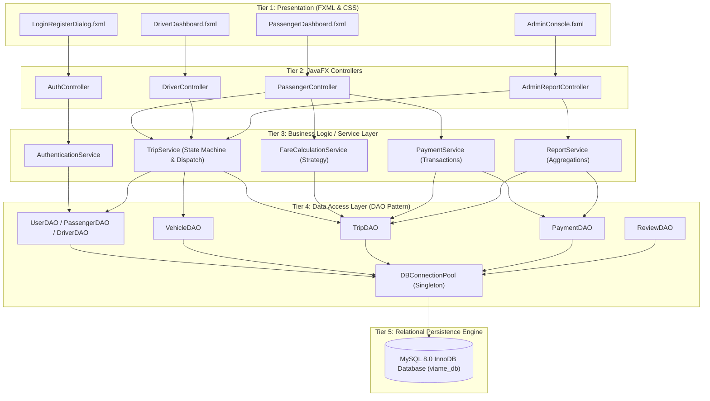

---

### 2.3 Component & Deployment Diagrams

#### Component Diagram
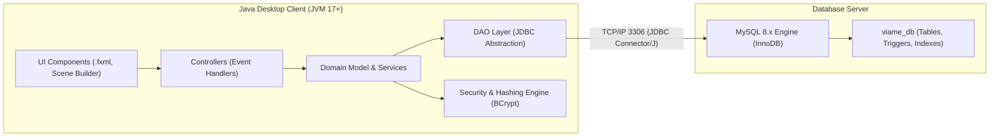

#### Deployment Diagram
```mermaid
graph TD
    node_workstation["Client Workstation\n(OS: Windows / Linux / macOS)\n[Java SE JRE 17+, JavaFX 17+]"] {
        artifact_jar["ViaMe-Application.jar"]
        artifact_fxml["resources/fxml/*.fxml & styles.css"]
        artifact_config["config/db.properties"]
    }

    node_db_server["Database Host Server\n[MySQL Server 8.0+]"] {
        artifact_db["Database: viame_db"]
        artifact_storage["InnoDB Storage Engine (ACID Log Files, Tablespaces)"]
    }

    node_workstation -- "Encrypted JDBC Socket Connection\n(Port 3306, SSL/TLS Enabled)" --> node_db_server
```

---

### 2.4 Complete Package Structure

```
com.viame
│
├── launcher
│   └── MainApp.java                    # JavaFX Application Entry point, Scene switcher
│
├── model
│   ├── User.java                       # Abstract base entity (encapsulation)
│   ├── Passenger.java                  # Extends User (ratings, wallet balance)
│   ├── Driver.java                     # Extends User (license, status, earnings)
│   ├── Admin.java                      # Extends User (staff privileges)
│   ├── Vehicle.java                    # Vehicle entity (registration, model, category)
│   ├── Location.java                   # Coordinate & Zone representation (latitude, longitude, name)
│   ├── Trip.java                       # Core Ride entity with full state machine
│   ├── Payment.java                    # Payment transaction record
│   ├── Review.java                     # Rating and review feedback
│   └── enums
│       ├── UserRole.java               # PASSENGER, DRIVER, ADMIN
│       ├── DriverStatus.java           # OFFLINE, AVAILABLE, ON_TRIP
│       ├── VehicleCategory.java        # STANDARD, COMFORT, VIP_VAN
│       ├── TripStatus.java             # REQUESTED, ACCEPTED, ARRIVED, IN_PROGRESS, COMPLETED, CANCELLED
│       └── PaymentMethod.java          # CASH, WALLET, MOBILE_MONEY
│
├── dao
│   ├── DBConnection.java               # Singleton connection manager & transaction provider
│   ├── GenericDAO.java                 # Generic interface with CRUD signatures (Generics)
│   ├── UserDAO.java                    # User-specific query signatures
│   ├── DriverDAO.java                  # Driver geolocation, status toggle, earnings
│   ├── VehicleDAO.java                 # Vehicle registration & assignment
│   ├── TripDAO.java                    # Complex trip queries, locking, historical lookup
│   ├── PaymentDAO.java                 # Payment logging, wallet atomic deduction
│   ├── ReviewDAO.java                  # Feedback submission and averages
│   └── impl
│       ├── UserDAOImpl.java            # JDBC implementation with PreparedStatements
│       ├── DriverDAOImpl.java          # JDBC implementation
│       ├── VehicleDAOImpl.java         # JDBC implementation
│       ├── TripDAOImpl.java            # JDBC implementation with transactional locks
│       ├── PaymentDAOImpl.java         # JDBC implementation
│       └── ReviewDAOImpl.java          # JDBC implementation
│
├── service
│   ├── AuthenticationService.java      # Login verification, BCrypt hashing, role extraction
│   ├── TripService.java                # Ride request dispatching, state transition validations
│   ├── FareCalculationService.java     # Base fare, distance, time, and dynamic surge pricing
│   ├── PaymentService.java             # Multi-step transactional wallet/cash settlement
│   ├── DriverMatchingService.java      # Proximity algorithm to locate nearest AVAILABLE driver
│   └── ReportService.java              # Aggregates 5 key business performance reports
│
├── controller
│   ├── LoginController.java            # User authentication & role-based routing
│   ├── RegisterController.java         # Registration with client-side regex validations
│   ├── PassengerDashboardController.java # Booking, ride tracking, payment pop-up
│   ├── DriverDashboardController.java    # Incoming radar, acceptance modal, ride completion
│   ├── AdminDashboardController.java     # Fleet overview, user management, fare tariffs
│   └── ReportViewController.java         # Visual charts (BarChart, PieChart, LineChart)
│
├── util
│   ├── PasswordHasher.java             # BCrypt hashing & salting utility
│   ├── SessionManager.java             # Thread-safe Singleton storing currently logged-in user
│   ├── InputValidator.java             # Centralized regex patterns (email, phone, plate number)
│   ├── DateUtil.java                   # Modern Java Time API (java.time.LocalDateTime) formatting
│   └── AlertHelper.java                # Standardized JavaFX Alert modal dialogs
│
└── exception
    ├── DatabaseException.java          # Unchecked wrapper for SQLException
    ├── AuthenticationException.java    # Invalid credentials or unauthorized role access
    ├── TripStateException.java         # Illegal ride lifecycle transitions
    ├── InsufficientFundsException.java # Wallet balance below ride fare
    └── DriverUnavailableException.java # Zero available drivers within radius
```

---

## 3. Comprehensive UML Modeling Suite

### 3.1 System Boundary & Use Case Diagram (20+ Use Cases)

The system accommodates three primary human actors (**Passenger**, **Driver**, and **Admin / Dispatcher**) and one system actor (**System Scheduler / Clock**).

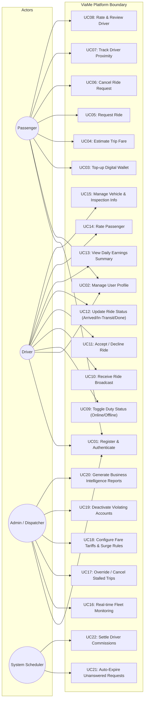

---

### 3.2 Detailed Class Diagram (Core Domain Model)

This diagram adheres strictly to OOP tenets: inheritance (`User` hierarchy), abstraction (`GenericDAO`), encapsulation (private fields with accessors), interfaces, and enums.

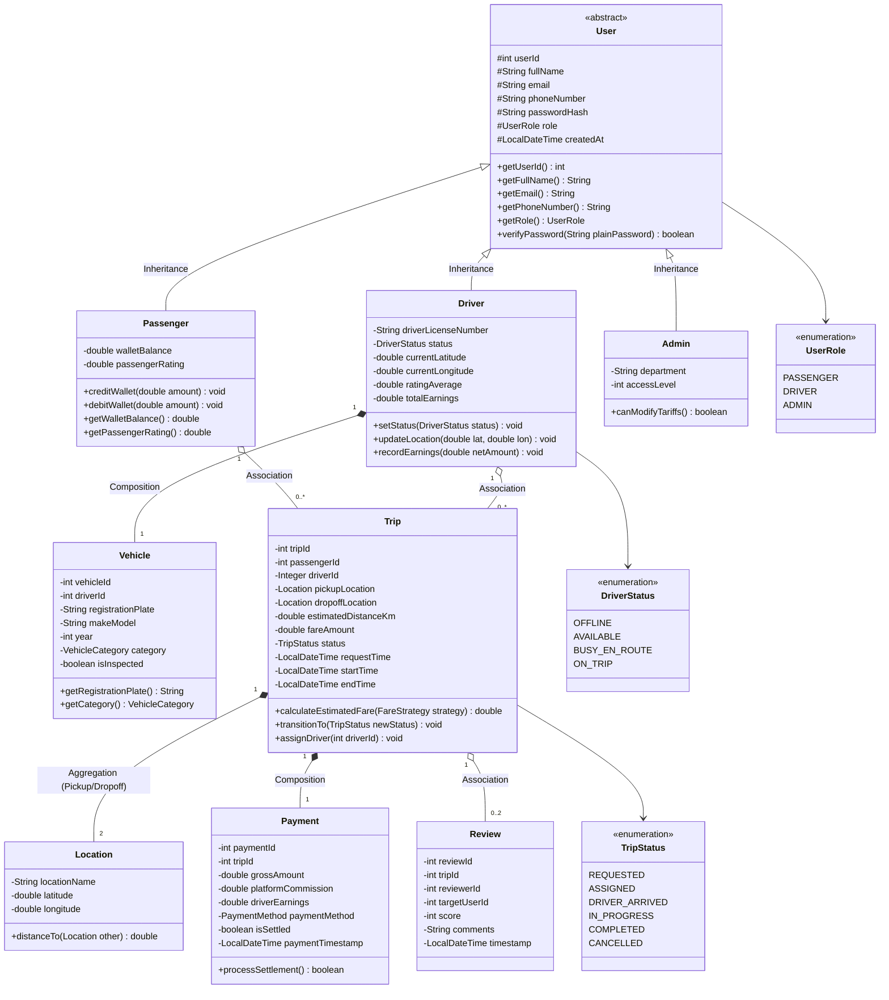

---

### 3.3 Sequence Diagrams (5 Core Interactions)

#### Sequence 1: User Authentication & Role-Based Session Routing
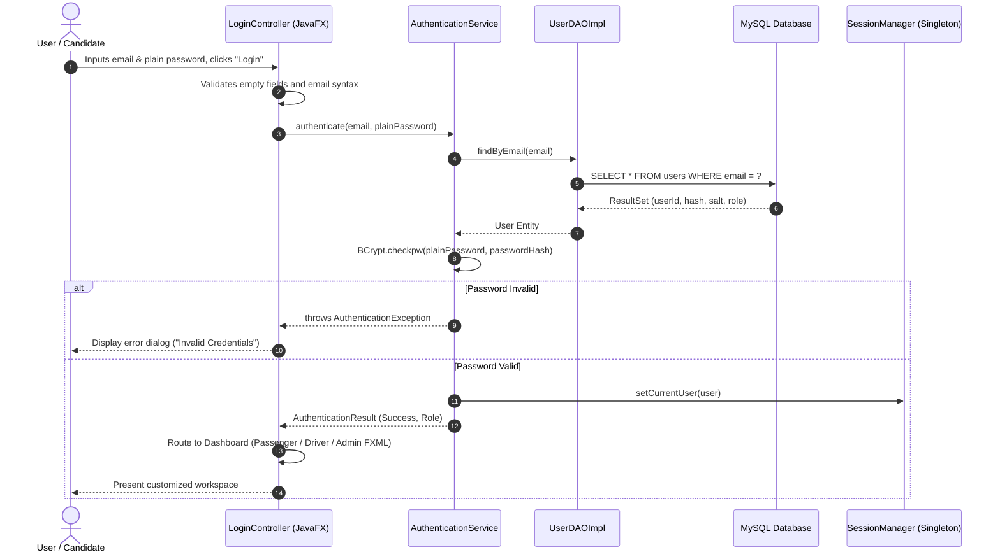

#### Sequence 2: Ride Request Creation, Fare Estimation & Proximity Driver Matching
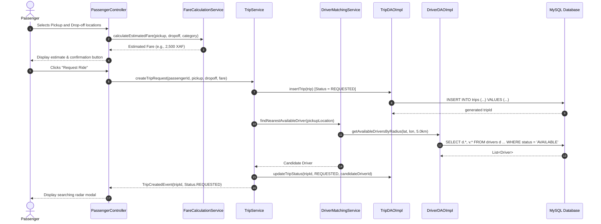

#### Sequence 3: Driver Ride Acceptance & Real-time Trip Lifecycle Execution
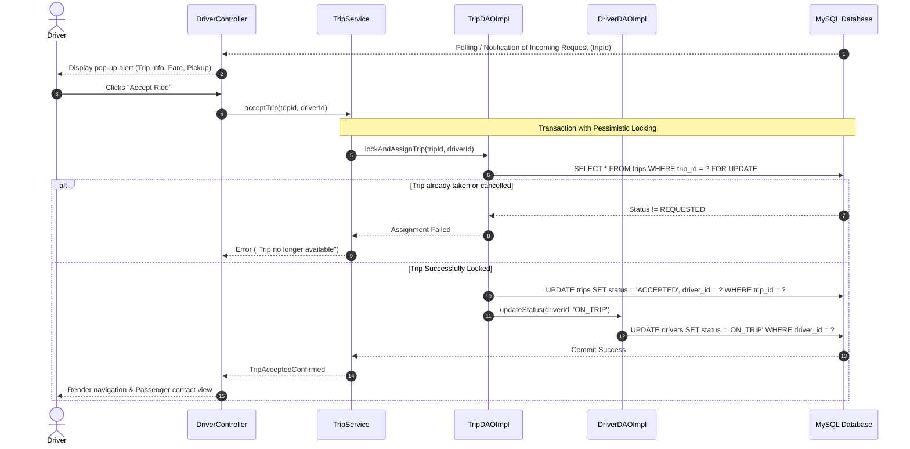

#### Sequence 4: Trip Completion, Payment Settlement & Atomic Wallet Deductions
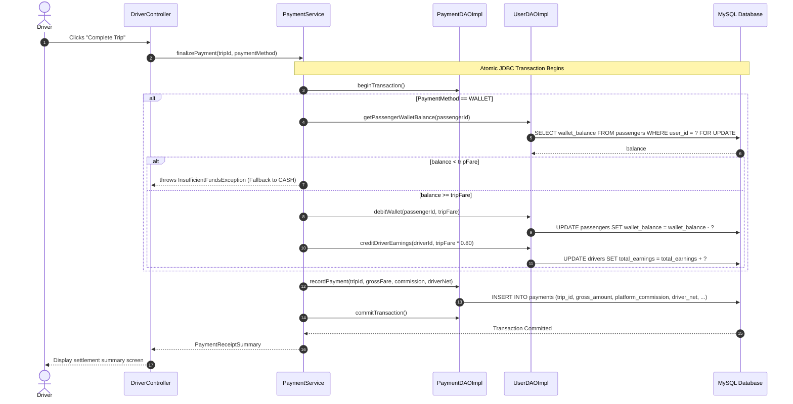

#### Sequence 5: Administrative Dynamic Reporting & Data Aggregation
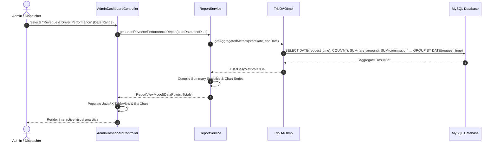

---

### 3.4 Activity Diagrams (5 Core Workflows)

#### Activity 1: Ride Booking & Driver Dispatch Workflow
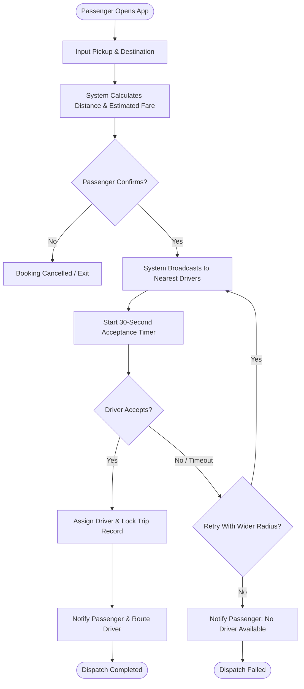

#### Activity 2: Driver Ride Execution & Location Simulation Workflow
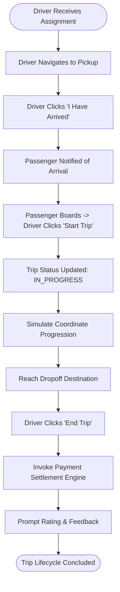

#### Activity 3: Fare Calculation & Dynamic Surge Pipeline
```mermaid
flowchart TD
    Start([Calculate Fare Invoked]) --> GetBase[Retrieve Vehicle Category Base Fare]
    GetBase --> GetDistanceRate[Multiply Distance by Per-Km Rate]
    GetDistanceRate --> GetTimeRate[Calculate Estimated Duration Fee]
    GetTimeRate --> CheckDemand[Query Active Requests vs Available Drivers]
    CheckDemand --> SurgeCheck{Demand / Supply Ratio > 1.5?}
    SurgeCheck -- Yes --> ApplySurge[Apply 1.3x - 1.8x Surge Multiplier]
    SurgeCheck -- No --> StandardRate[Surge Multiplier = 1.0]
    ApplySurge --> ComputeTotal[Compute Total = (Base + Dist + Time) * Surge]
    StandardRate --> ComputeTotal
    ComputeTotal --> RoundCurrency[Round to Nearest Currency Unit]
    RoundCurrency --> OutputFare([Return Guaranteed Fare])
```

#### Activity 4: Driver Onboarding & Document Verification (AD-2)
*Source:* [`docs/uml/ViaMe_AD2_Onboarding.puml`](file:///c:/Users/TOUTENUN/Desktop/ViaMe/docs/uml/ViaMe_AD2_Onboarding.puml)  
*Online Renderings:* [Vector SVG](https://www.plantuml.com/plantuml/svg/~1ZL9DJyCm3BtdL_ZO2G7IZfiGL6i5HLjNZT7hb3NkPj4c9Kc7-6NS-MMuNVaOui39Zf_ztfET6-UbzMrTGKvoWPim6c-MUckaLQHtmfEl4CBeV0mGMJgW1VEDYdvOJ0R4jTkQl8C6hJDQLg2abt065HMe2voAoSFGSS0z5Koiq4kgd82WgQH7U7-3MZuTer5OTOb3wTreAgY406jkXqjezaPZ5_kfLjDpYzSZy7lK4BoY6mc0oSnYZpgsbiLfbAItN6O_ghUxQQmfYKsSO9_EXkAq8mfLJHei7WXV72XJj3LgxpgiCoKRPZgW-cs09q-LBZYdaWhfoMYuWZ3BLiiyZgR7va7wWfVgMzVXitMInmCwxBYG6dO6bkayINi8AuSGQFClnLLy7y_MNuhvRyKa_KjJ6yyag23WZV9bHxskLbIAd-gJXxrvWSBeaW_k0QqrjkC9eiTidip2TRo95s4ovxjbTyiqxkASgqnt97FUD4BSy8F_e_W0) | [Raster PNG](https://www.plantuml.com/plantuml/png/~1ZL9DJyCm3BtdL_ZO2G7IZfiGL6i5HLjNZT7hb3NkPj4c9Kc7-6NS-MMuNVaOui39Zf_ztfET6-UbzMrTGKvoWPim6c-MUckaLQHtmfEl4CBeV0mGMJgW1VEDYdvOJ0R4jTkQl8C6hJDQLg2abt065HMe2voAoSFGSS0z5Koiq4kgd82WgQH7U7-3MZuTer5OTOb3wTreAgY406jkXqjezaPZ5_kfLjDpYzSZy7lK4BoY6mc0oSnYZpgsbiLfbAItN6O_ghUxQQmfYKsSO9_EXkAq8mfLJHei7WXV72XJj3LgxpgiCoKRPZgW-cs09q-LBZYdaWhfoMYuWZ3BLiiyZgR7va7wWfVgMzVXitMInmCwxBYG6dO6bkayINi8AuSGQFClnLLy7y_MNuhvRyKa_KjJ6yyag23WZV9bHxskLbIAd-gJXxrvWSBeaW_k0QqrjkC9eiTidip2TRo95s4ovxjbTyiqxkASgqnt97FUD4BSy8F_e_W0)

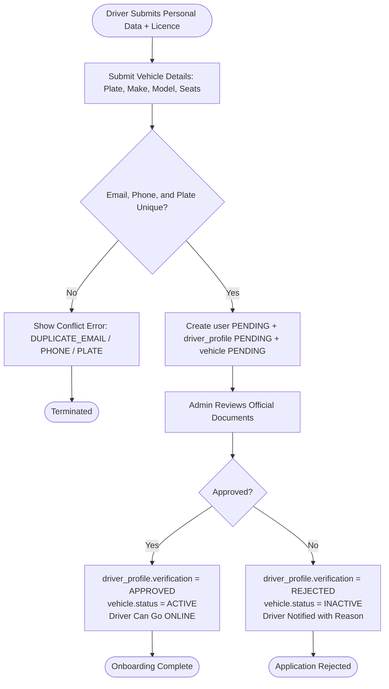

#### Activity 5: Administrator Pricing Rule Configuration & Auditing (AD-3)
*Source:* [`docs/uml/ViaMe_AD3_Pricing.puml`](file:///c:/Users/TOUTENUN/Desktop/ViaMe/docs/uml/ViaMe_AD3_Pricing.puml)  
*Online Renderings:* [Vector SVG](https://www.plantuml.com/plantuml/svg/~1DL51RW8n3Bpd5NE4GoaLDn0jI0YfggYgLcgFADqrYwLiih8J4BU-fb_elK_fIngoS8hi6S-CdOL6Ap6r3kziDxHThYRR5-6AVMCYHqTOhcucmB9ksQCAViTD4b9qFGcI7AanHSPCUrheo2ikCj1AYFpi2bBDKV5fbTPM2BVeI9xQ_jra_1QQfA6PuHq61-kujf63HsTLIHyC0EiSxkSOu_Ud9-DkDCRVrpSce_4GSKyUWnFfC9EdAx9Lv8EDX2g9a8ye3IhHPsVAerUI24_7wrhRCuQB_rf2YpbyE0uB_KCuYzcK5zcwq21BogaWprb1kCxdIKhd74Mpzo6NMmCVIgYtVJY2lMDF894WPVoLD8Pyaqxem24fidqYpRE-vbs-SUYCMUGY_vVv1m) | [Raster PNG](https://www.plantuml.com/plantuml/png/~1DL51RW8n3Bpd5NE4GoaLDn0jI0YfggYgLcgFADqrYwLiih8J4BU-fb_elK_fIngoS8hi6S-CdOL6Ap6r3kziDxHThYRR5-6AVMCYHqTOhcucmB9ksQCAViTD4b9qFGcI7AanHSPCUrheo2ikCj1AYFpi2bBDKV5fbTPM2BVeI9xQ_jra_1QQfA6PuHq61-kujf63HsTLIHyC0EiSxkSOu_Ud9-DkDCRVrpSce_4GSKyUWnFfC9EdAx9Lv8EDX2g9a8ye3IhHPsVAerUI24_7wrhRCuQB_rf2YpbyE0uB_KCuYzcK5zcwq21BogaWprb1kCxdIKhd74Mpzo6NMmCVIgYtVJY2lMDF894WPVoLD8Pyaqxem24fidqYpRE-vbs-SUYCMUGY_vVv1m)

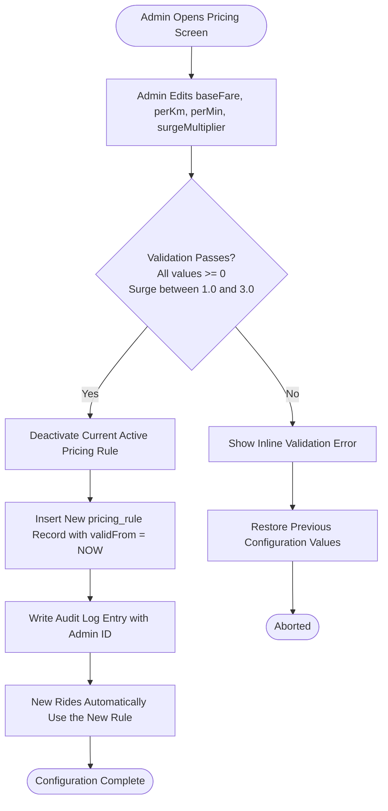

---

### 3.5 State Machine Diagram (Key Entity: `Ride`)
*Source:* [`docs/uml/ViaMe_StateRide.puml`](file:///c:/Users/TOUTENUN/Desktop/ViaMe/docs/uml/ViaMe_StateRide.puml)  
*Online Renderings:* [Vector SVG](https://www.plantuml.com/plantuml/svg/~1VLHDZzCm4BtxLuo4X7QHkXmgSUW1xTAcgqfjiYJjNX3g6cUQcZfsP3kxL0Y97y4lv9SmJZ_J03aby-RvlPdC-DPvRdrTAdYKV8RBp7EFgSoHUUaLGlCDCoxMKYFy_laB0WXAhb1iXKB6t4RgYbjUWcjolpE03rni2cjgdG-DCXPUZKVZTr4_8CRcQFVHVlDGzCvQyz8E_c3iqvlFqEkzXpJwk8YoUJI20LJSETG5MX16hwGj7MCdF6JVPTdaFgQFmpE0tCfdOfZL2Ytcy1gu45Xvp2-eSR8SfPF7A5sEaqKy2bHjG72TopoKzXRwOF4h2Y-DTXVauLqyZARJat3BBDS2bOEhbKMyPkneCZ3tcb6yJ9F5F3gtl3FgsladtKw9EtUEd7fPegbzczdnICoTDNA62Bogb4H71YyzDPrDGt3K4kGUAYasTVLNnfdUluGEXuRqIRnyI9FxDCgoJcNDd3hmLbOjJhUaLkErwRcrURbKFLTgJabc3zFesDAZgZ1bfT2ZwpBQkWF04cs1McptXJ9sSIWqF1fgrl5y03e3U02ODZH_LXPhJsDyd75QdOXiRgajN3iPnXAaWsUkce7DmQ4blEV2GWDSXTtDA2G5Nj_0H2aik3eZKt_Nj8cKkiUQzPyVyUXR64TwkM6eSmYc_cCjeTHIEYy5A2CsGEQUo8qZ_XF1HSrjxY0tzHUwQEYFoKANgFtvsRVqIfSJ-mC) | [Raster PNG](https://www.plantuml.com/plantuml/png/~1VLHDZzCm4BtxLuo4X7QHkXmgSUW1xTAcgqfjiYJjNX3g6cUQcZfsP3kxL0Y97y4lv9SmJZ_J03aby-RvlPdC-DPvRdrTAdYKV8RBp7EFgSoHUUaLGlCDCoxMKYFy_laB0WXAhb1iXKB6t4RgYbjUWcjolpE03rni2cjgdG-DCXPUZKVZTr4_8CRcQFVHVlDGzCvQyz8E_c3iqvlFqEkzXpJwk8YoUJI20LJSETG5MX16hwGj7MCdF6JVPTdaFgQFmpE0tCfdOfZL2Ytcy1gu45Xvp2-eSR8SfPF7A5sEaqKy2bHjG72TopoKzXRwOF4h2Y-DTXVauLqyZARJat3BBDS2bOEhbKMyPkneCZ3tcb6yJ9F5F3gtl3FgsladtKw9EtUEd7fPegbzczdnICoTDNA62Bogb4H71YyzDPrDGt3K4kGUAYasTVLNnfdUluGEXuRqIRnyI9FxDCgoJcNDd3hmLbOjJhUaLkErwRcrURbKFLTgJabc3zFesDAZgZ1bfT2ZwpBQkWF04cs1McptXJ9sSIWqF1fgrl5y03e3U02ODZH_LXPhJsDyd75QdOXiRgajN3iPnXAaWsUkce7DmQ4blEV2GWDSXTtDA2G5Nj_0H2aik3eZKt_Nj8cKkiUQzPyVyUXR64TwkM6eSmYc_cCjeTHIEYy5A2CsGEQUo8qZ_XF1HSrjxY0tzHUwQEYFoKANgFtvsRVqIfSJ-mC)

The lifecycle of a transport ride represents the core transactional engine of ViaMe. Transitions are strictly validated server-side by `RideService`. Any illegal progression throws a custom `IllegalStateTransitionException`. Furthermore, an **optimistic lock on the `version` column** in MySQL guarantees protection against concurrent double-assignments.

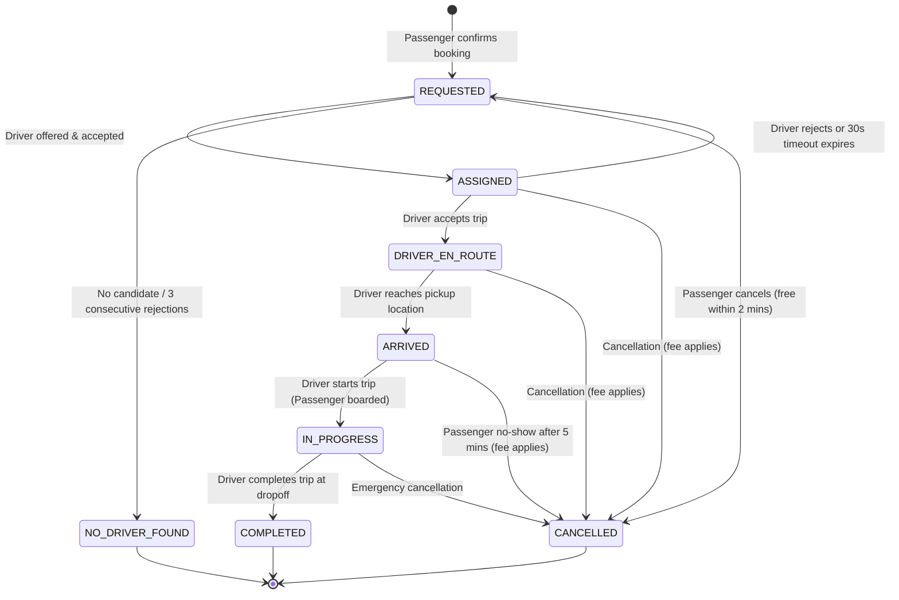

---

### 3.6 PlantUML Diagram Suite & Architectural Evaluation

The project repository includes the formal `.puml` files inside the [`docs/uml/`](file:///c:/Users/TOUTENUN/Desktop/ViaMe/docs/uml/) directory. Below is the technical review of each diagram against the **ISJ Java Programming II Examination Rubric (Engr Tanwi Nkiamboh)**:

| Diagram Name | Artifact Path | Compiled Links | Rubric Evaluation & Defense Rationale |
| :--- | :--- | :--- | :--- |
| **ViaMe_ERD** (Conceptual ERD) | [`docs/uml/ViaMe_ERD.puml`](file:///c:/Users/TOUTENUN/Desktop/ViaMe/docs/uml/ViaMe_ERD.puml) | [SVG Render](https://www.plantuml.com/plantuml/svg/~1dLVTSgCs5BxdAJJfXPETP2Qx-PbsPsTdYS5PMXkxsCvChXW5P5iJG5GIITDDP_eGVS8-IOyam623iorNmFaa7RxpdH--28cvBD84tL4y8Q4RE9QaCY7c6VtprzzeoBA8vBB02G8pEiutBu96y4JJF24foIIMb6Me44GWaU574aPO42JnGqB4YMLjQ4nGIkI6nS8y24auOV8b9y8IZpJBCSSfIcX6r3l4E60R1h71CNkcsHgjS298mnAJ5IuIEMAPz75Aq9oi6K5BhnioftyGzFwyOGJdgNn1too4Rd3qkEQioE8XInX7FuoSqRLxeIoCnuINRo_qPVrfMUNQ8_XkVeImGCkv6-YjtY4Qe-tr4Trujvw_G9y-pNxv_1a0PsSQHL9CaotgpWw6N-tW-FtL-GbWbmRx3kKRbf5zs0T0jM1OY6TmDTnWiMdYhgvEsW214za0N5yQEsS9QJZj-il9yM1cp-UkV-i6WzE14tXt-iPs9fu_CAj0GR8GEwliuGAWW9ovlkFvjt0tNyxLW-kKwo9Ei2HnYALUvzWBT-5Dt2Qpoc6IhGaFSyvMD26Qvjci95aH7xQOtYNx58rQXA-A90ap9PJMYffueDHIhqhDX3b-KVeEZNZRt3STZJbzsl7IEUZb_t1ptyzta34HWUGCio9z87mVUDaM4lX8Lv2wAbt3EcvrfEjGsRDPCBs3I9qE0lTdTxWeWuOGXxNPEiHFwxPdZZlq9lRu-EBqW_4CFu6qyGDD53zxefhwOyzNyfYEHjMT7ou2RpPeyVf4DZGg2Rrpl_wdv2fZOi0DrAZEbmJqLr7NJgi6PodKiuuGN9OHI5bCEbAuCWlGkDYQmOF-d6dmNsMFvvUtBLOub51DIU0vRXSd1rZPffHUiSyBQXFN3IdZKc4wsUKqKbBXXS5rOcZqMEHXeaj0KqO_dLwVj13P-Wq4ZcDEXEWgUp5dELkjgcCwzgWHvfW3Y4F7K8YgIiR7jBt9TPKJSS5DwgKqwvV3LX21--lIdIzq7a8LzcvzVMkgSEZwOJ1TBa0c5kgz1dQWq8xMKWXPVHkuypay3QUJsTZLUnzQFhJzeJiUwmtyQLWUFPek_QgCS_9RGKHN8LSRu4YD3fLnrwg7ZzguQusOcY_wTeuKrqdIQTMLJgYPf9LvZHHQOMvIQ6G7FIbqA8jK1ePzPMW4zRmk7mym2ONgj0Qo4iRxyrePbNRKDqEppsGNIjAqWUZRInHyJS8KsXVD4wgwmXPrMM_594v2dCAu8_lTYWhEeR-q2dYb-ukJTgVMZTBqP_k-Xz7lvhEhM3ITxNEuxDCDZCcaeHqe1K-cDzxO3ITJtxtlcbvGLp6UsPvQExAzSTaHHyjwZ458Sfm97EcyvcJLOEZ7PYD1K7bfhVGTjJThkswmfhhRYtqUluV2BlPWt_wQRyoatomYLYdu8rfu_hsfN3f7qrgBrOTVdP_lZNWz0rwZIHZjT0xG1p_ym9nqNVgnbuHTsic17rEwtm2Pwdq0j9U17Gce5FD4MgVTJATZr_PD_S89g6N5MRezfuC_-EDIPKvJDuV2Nf8dsIF9Tdy3OChVuwunctQ5dVoUKsXtE_5JQDhLSI-lMZK15p6LOSACcksbyzrgHcyvPlAjCzge-gTh6ozRHhrrjV5XgGx09RXGG1BTlCM6vW8THvmz3mHQCIPF3CBIlt-lhsTdx5Nze-ZZZwX0U3jq7RL0JWjangucufk9gKBWGcwKwp2x4z76A68rPaqometTqbkN03KuQm1xpi0sQvZq0AbCPHS7izDbXcWygNtrLhj6Y5KCH83haBtxPjMm2l0AwPvhMTgWGA-lflig46WLGLSxsbeLYT18okEbX4wF7bwQW6-wGfRkHuHg3wql98kBDB7-1G) \| [PNG](https://www.plantuml.com/plantuml/png/~1dLVTSgCs5BxdAJJfXPETP2Qx-PbsPsTdYS5PMXkxsCvChXW5P5iJG5GIITDDP_eGVS8-IOyam623iorNmFaa7RxpdH--28cvBD84tL4y8Q4RE9QaCY7c6VtprzzeoBA8vBB02G8pEiutBu96y4JJF24foIIMb6Me44GWaU574aPO42JnGqB4YMLjQ4nGIkI6nS8y24auOV8b9y8IZpJBCSSfIcX6r3l4E60R1h71CNkcsHgjS298mnAJ5IuIEMAPz75Aq9oi6K5BhnioftyGzFwyOGJdgNn1too4Rd3qkEQioE8XInX7FuoSqRLxeIoCnuINRo_qPVrfMUNQ8_XkVeImGCkv6-YjtY4Qe-tr4Trujvw_G9y-pNxv_1a0PsSQHL9CaotgpWw6N-tW-FtL-GbWbmRx3kKRbf5zs0T0jM1OY6TmDTnWiMdYhgvEsW214za0N5yQEsS9QJZj-il9yM1cp-UkV-i6WzE14tXt-iPs9fu_CAj0GR8GEwliuGAWW9ovlkFvjt0tNyxLW-kKwo9Ei2HnYALUvzWBT-5Dt2Qpoc6IhGaFSyvMD26Qvjci95aH7xQOtYNx58rQXA-A90ap9PJMYffueDHIhqhDX3b-KVeEZNZRt3STZJbzsl7IEUZb_t1ptyzta34HWUGCio9z87mVUDaM4lX8Lv2wAbt3EcvrfEjGsRDPCBs3I9qE0lTdTxWeWuOGXxNPEiHFwxPdZZlq9lRu-EBqW_4CFu6qyGDD53zxefhwOyzNyfYEHjMT7ou2RpPeyVf4DZGg2Rrpl_wdv2fZOi0DrAZEbmJqLr7NJgi6PodKiuuGN9OHI5bCEbAuCWlGkDYQmOF-d6dmNsMFvvUtBLOub51DIU0vRXSd1rZPffHUiSyBQXFN3IdZKc4wsUKqKbBXXS5rOcZqMEHXeaj0KqO_dLwVj13P-Wq4ZcDEXEWgUp5dELkjgcCwzgWHvfW3Y4F7K8YgIiR7jBt9TPKJSS5DwgKqwvV3LX21--lIdIzq7a8LzcvzVMkgSEZwOJ1TBa0c5kgz1dQWq8xMKWXPVHkuypay3QUJsTZLUnzQFhJzeJiUwmtyQLWUFPek_QgCS_9RGKHN8LSRu4YD3fLnrwg7ZzguQusOcY_wTeuKrqdIQTMLJgYPf9LvZHHQOMvIQ6G7FIbqA8jK1ePzPMW4zRmk7mym2ONgj0Qo4iRxyrePbNRKDqEppsGNIjAqWUZRInHyJS8KsXVD4wgwmXPrMM_594v2dCAu8_lTYWhEeR-q2dYb-ukJTgVMZTBqP_k-Xz7lvhEhM3ITxNEuxDCDZCcaeHqe1K-cDzxO3ITJtxtlcbvGLp6UsPvQExAzSTaHHyjwZ458Sfm97EcyvcJLOEZ7PYD1K7bfhVGTjJThkswmfhhRYtqUluV2BlPWt_wQRyoatomYLYdu8rfu_hsfN3f7qrgBrOTVdP_lZNWz0rwZIHZjT0xG1p_ym9nqNVgnbuHTsic17rEwtm2Pwdq0j9U17Gce5FD4MgVTJATZr_PD_S89g6N5MRezfuC_-EDIPKvJDuV2Nf8dsIF9Tdy3OChVuwunctQ5dVoUKsXtE_5JQDhLSI-lMZK15p6LOSACcksbyzrgHcyvPlAjCzge-gTh6ozRHhrrjV5XgGx09RXGG1BTlCM6vW8THvmz3mHQCIPF3CBIlt-lhsTdx5Nze-ZZZwX0U3jq7RL0JWjangucufk9gKBWGcwKwp2x4z76A68rPaqometTqbkN03KuQm1xpi0sQvZq0AbCPHS7izDbXcWygNtrLhj6Y5KCH83haBtxPjMm2l0AwPvhMTgWGA-lflig46WLGLSxsbeLYT18okEbX4wF7bwQW6-wGfRkHuHg3wql98kBDB7-1G) | **Exceeds Task T3:** Features 11 normalized entities in 3NF. Separates `user` identity from `passenger_profile` and `driver_profile`. Decouples dynamic `pricing_rule` from historical `fare` calculations. Integrates session management and audit trails. |
| **ViaMe_StateRide** (Ride Lifecycle State Machine) | [`docs/uml/ViaMe_StateRide.puml`](file:///c:/Users/TOUTENUN/Desktop/ViaMe/docs/uml/ViaMe_StateRide.puml) | [SVG Render](https://www.plantuml.com/plantuml/svg/~1VLHDZzCm4BtxLuo4X7QHkXmgSUW1xTAcgqfjiYJjNX3g6cUQcZfsP3kxL0Y97y4lv9SmJZ_J03aby-RvlPdC-DPvRdrTAdYKV8RBp7EFgSoHUUaLGlCDCoxMKYFy_laB0WXAhb1iXKB6t4RgYbjUWcjolpE03rni2cjgdG-DCXPUZKVZTr4_8CRcQFVHVlDGzCvQyz8E_c3iqvlFqEkzXpJwk8YoUJI20LJSETG5MX16hwGj7MCdF6JVPTdaFgQFmpE0tCfdOfZL2Ytcy1gu45Xvp2-eSR8SfPF7A5sEaqKy2bHjG72TopoKzXRwOF4h2Y-DTXVauLqyZARJat3BBDS2bOEhbKMyPkneCZ3tcb6yJ9F5F3gtl3FgsladtKw9EtUEd7fPegbzczdnICoTDNA62Bogb4H71YyzDPrDGt3K4kGUAYasTVLNnfdUluGEXuRqIRnyI9FxDCgoJcNDd3hmLbOjJhUaLkErwRcrURbKFLTgJabc3zFesDAZgZ1bfT2ZwpBQkWF04cs1McptXJ9sSIWqF1fgrl5y03e3U02ODZH_LXPhJsDyd75QdOXiRgajN3iPnXAaWsUkce7DmQ4blEV2GWDSXTtDA2G5Nj_0H2aik3eZKt_Nj8cKkiUQzPyVyUXR64TwkM6eSmYc_cCjeTHIEYy5A2CsGEQUo8qZ_XF1HSrjxY0tzHUwQEYFoKANgFtvsRVqIfSJ-mC) \| [PNG](https://www.plantuml.com/plantuml/png/~1VLHDZzCm4BtxLuo4X7QHkXmgSUW1xTAcgqfjiYJjNX3g6cUQcZfsP3kxL0Y97y4lv9SmJZ_J03aby-RvlPdC-DPvRdrTAdYKV8RBp7EFgSoHUUaLGlCDCoxMKYFy_laB0WXAhb1iXKB6t4RgYbjUWcjolpE03rni2cjgdG-DCXPUZKVZTr4_8CRcQFVHVlDGzCvQyz8E_c3iqvlFqEkzXpJwk8YoUJI20LJSETG5MX16hwGj7MCdF6JVPTdaFgQFmpE0tCfdOfZL2Ytcy1gu45Xvp2-eSR8SfPF7A5sEaqKy2bHjG72TopoKzXRwOF4h2Y-DTXVauLqyZARJat3BBDS2bOEhbKMyPkneCZ3tcb6yJ9F5F3gtl3FgsladtKw9EtUEd7fPegbzczdnICoTDNA62Bogb4H71YyzDPrDGt3K4kGUAYasTVLNnfdUluGEXuRqIRnyI9FxDCgoJcNDd3hmLbOjJhUaLkErwRcrURbKFLTgJabc3zFesDAZgZ1bfT2ZwpBQkWF04cs1McptXJ9sSIWqF1fgrl5y03e3U02ODZH_LXPhJsDyd75QdOXiRgajN3iPnXAaWsUkce7DmQ4blEV2GWDSXTtDA2G5Nj_0H2aik3eZKt_Nj8cKkiUQzPyVyUXR64TwkM6eSmYc_cCjeTHIEYy5A2CsGEQUo8qZ_XF1HSrjxY0tzHUwQEYFoKANgFtvsRVqIfSJ-mC) | **Fulfills Task T2:** Robust state model for the key entity `Ride`. Covers all nominal, cancellation, timeout, and no-driver branches. Incorporates optimistic locking (`version`) and server-side exception handling. |
| **ViaMe_AD2_Onboarding** (Driver Onboarding) | [`docs/uml/ViaMe_AD2_Onboarding.puml`](file:///c:/Users/TOUTENUN/Desktop/ViaMe/docs/uml/ViaMe_AD2_Onboarding.puml) | [SVG Render](https://www.plantuml.com/plantuml/svg/~1ZL9DJyCm3BtdL_ZO2G7IZfiGL6i5HLjNZT7hb3NkPj4c9Kc7-6NS-MMuNVaOui39Zf_ztfET6-UbzMrTGKvoWPim6c-MUckaLQHtmfEl4CBeV0mGMJgW1VEDYdvOJ0R4jTkQl8C6hJDQLg2abt065HMe2voAoSFGSS0z5Koiq4kgd82WgQH7U7-3MZuTer5OTOb3wTreAgY406jkXqjezaPZ5_kfLjDpYzSZy7lK4BoY6mc0oSnYZpgsbiLfbAItN6O_ghUxQQmfYKsSO9_EXkAq8mfLJHei7WXV72XJj3LgxpgiCoKRPZgW-cs09q-LBZYdaWhfoMYuWZ3BLiiyZgR7va7wWfVgMzVXitMInmCwxBYG6dO6bkayINi8AuSGQFClnLLy7y_MNuhvRyKa_KjJ6yyag23WZV9bHxskLbIAd-gJXxrvWSBeaW_k0QqrjkC9eiTidip2TRo95s4ovxjbTyiqxkASgqnt97FUD4BSy8F_e_W0) \| [PNG](https://www.plantuml.com/plantuml/png/~1ZL9DJyCm3BtdL_ZO2G7IZfiGL6i5HLjNZT7hb3NkPj4c9Kc7-6NS-MMuNVaOui39Zf_ztfET6-UbzMrTGKvoWPim6c-MUckaLQHtmfEl4CBeV0mGMJgW1VEDYdvOJ0R4jTkQl8C6hJDQLg2abt065HMe2voAoSFGSS0z5Koiq4kgd82WgQH7U7-3MZuTer5OTOb3wTreAgY406jkXqjezaPZ5_kfLjDpYzSZy7lK4BoY6mc0oSnYZpgsbiLfbAItN6O_ghUxQQmfYKsSO9_EXkAq8mfLJHei7WXV72XJj3LgxpgiCoKRPZgW-cs09q-LBZYdaWhfoMYuWZ3BLiiyZgR7va7wWfVgMzVXitMInmCwxBYG6dO6bkayINi8AuSGQFClnLLy7y_MNuhvRyKa_KjJ6yyag23WZV9bHxskLbIAd-gJXxrvWSBeaW_k0QqrjkC9eiTidip2TRo95s4ovxjbTyiqxkASgqnt97FUD4BSy8F_e_W0) | **Fulfills Task T2:** Essential administrative and security workflow. Enforces document validation, state transitions from `PENDING` to `APPROVED`/`REJECTED`, and vehicle linking prior to `ONLINE` authorization. |
| **ViaMe_AD3_Pricing** (Pricing Rules) | [`docs/uml/ViaMe_AD3_Pricing.puml`](file:///c:/Users/TOUTENUN/Desktop/ViaMe/docs/uml/ViaMe_AD3_Pricing.puml) | [SVG Render](https://www.plantuml.com/plantuml/svg/~1DL51RW8n3Bpd5NE4GoaLDn0jI0YfggYgLcgFADqrYwLiih8J4BU-fb_elK_fIngoS8hi6S-CdOL6Ap6r3kziDxHThYRR5-6AVMCYHqTOhcucmB9ksQCAViTD4b9qFGcI7AanHSPCUrheo2ikCj1AYFpi2bBDKV5fbTPM2BVeI9xQ_jra_1QQfA6PuHq61-kujf63HsTLIHyC0EiSxkSOu_Ud9-DkDCRVrpSce_4GSKyUWnFfC9EdAx9Lv8EDX2g9a8ye3IhHPsVAerUI24_7wrhRCuQB_rf2YpbyE0uB_KCuYzcK5zcwq21BogaWprb1kCxdIKhd74Mpzo6NMmCVIgYtVJY2lMDF894WPVoLD8Pyaqxem24fidqYpRE-vbs-SUYCMUGY_vVv1m) \| [PNG](https://www.plantuml.com/plantuml/png/~1DL51RW8n3Bpd5NE4GoaLDn0jI0YfggYgLcgFADqrYwLiih8J4BU-fb_elK_fIngoS8hi6S-CdOL6Ap6r3kziDxHThYRR5-6AVMCYHqTOhcucmB9ksQCAViTD4b9qFGcI7AanHSPCUrheo2ikCj1AYFpi2bBDKV5fbTPM2BVeI9xQ_jra_1QQfA6PuHq61-kujf63HsTLIHyC0EiSxkSOu_Ud9-DkDCRVrpSce_4GSKyUWnFfC9EdAx9Lv8EDX2g9a8ye3IhHPsVAerUI24_7wrhRCuQB_rf2YpbyE0uB_KCuYzcK5zcwq21BogaWprb1kCxdIKhd74Mpzo6NMmCVIgYtVJY2lMDF894WPVoLD8Pyaqxem24fidqYpRE-vbs-SUYCMUGY_vVv1m) | **Fulfills Task T2 & T7:** Illustrates server-side protection of sensitive financial parameters. Demonstrates input bounds validation (`surge 1.0 ... 3.0`) and immutable historical versioning (`validFrom`). |


---

## 4. Database Design & Relational Schema (3NF)

### 4.1 Conceptual Entity-Relationship Diagram (ERD)
*Source:* [`docs/uml/ViaMe_ERD.puml`](file:///c:/Users/TOUTENUN/Desktop/ViaMe/docs/uml/ViaMe_ERD.puml)  
*Online Renderings:* [Vector SVG](https://www.plantuml.com/plantuml/svg/~1dLVTSgCs5BxdAJJfXPETP2Qx-PbsPsTdYS5PMXkxsCvChXW5P5iJG5GIITDDP_eGVS8-IOyam623iorNmFaa7RxpdH--28cvBD84tL4y8Q4RE9QaCY7c6VtprzzeoBA8vBB02G8pEiutBu96y4JJF24foIIMb6Me44GWaU574aPO42JnGqB4YMLjQ4nGIkI6nS8y24auOV8b9y8IZpJBCSSfIcX6r3l4E60R1h71CNkcsHgjS298mnAJ5IuIEMAPz75Aq9oi6K5BhnioftyGzFwyOGJdgNn1too4Rd3qkEQioE8XInX7FuoSqRLxeIoCnuINRo_qPVrfMUNQ8_XkVeImGCkv6-YjtY4Qe-tr4Trujvw_G9y-pNxv_1a0PsSQHL9CaotgpWw6N-tW-FtL-GbWbmRx3kKRbf5zs0T0jM1OY6TmDTnWiMdYhgvEsW214za0N5yQEsS9QJZj-il9yM1cp-UkV-i6WzE14tXt-iPs9fu_CAj0GR8GEwliuGAWW9ovlkFvjt0tNyxLW-kKwo9Ei2HnYALUvzWBT-5Dt2Qpoc6IhGaFSyvMD26Qvjci95aH7xQOtYNx58rQXA-A90ap9PJMYffueDHIhqhDX3b-KVeEZNZRt3STZJbzsl7IEUZb_t1ptyzta34HWUGCio9z87mVUDaM4lX8Lv2wAbt3EcvrfEjGsRDPCBs3I9qE0lTdTxWeWuOGXxNPEiHFwxPdZZlq9lRu-EBqW_4CFu6qyGDD53zxefhwOyzNyfYEHjMT7ou2RpPeyVf4DZGg2Rrpl_wdv2fZOi0DrAZEbmJqLr7NJgi6PodKiuuGN9OHI5bCEbAuCWlGkDYQmOF-d6dmNsMFvvUtBLOub51DIU0vRXSd1rZPffHUiSyBQXFN3IdZKc4wsUKqKbBXXS5rOcZqMEHXeaj0KqO_dLwVj13P-Wq4ZcDEXEWgUp5dELkjgcCwzgWHvfW3Y4F7K8YgIiR7jBt9TPKJSS5DwgKqwvV3LX21--lIdIzq7a8LzcvzVMkgSEZwOJ1TBa0c5kgz1dQWq8xMKWXPVHkuypay3QUJsTZLUnzQFhJzeJiUwmtyQLWUFPek_QgCS_9RGKHN8LSRu4YD3fLnrwg7ZzguQusOcY_wTeuKrqdIQTMLJgYPf9LvZHHQOMvIQ6G7FIbqA8jK1ePzPMW4zRmk7mym2ONgj0Qo4iRxyrePbNRKDqEppsGNIjAqWUZRInHyJS8KsXVD4wgwmXPrMM_594v2dCAu8_lTYWhEeR-q2dYb-ukJTgVMZTBqP_k-Xz7lvhEhM3ITxNEuxDCDZCcaeHqe1K-cDzxO3ITJtxtlcbvGLp6UsPvQExAzSTaHHyjwZ458Sfm97EcyvcJLOEZ7PYD1K7bfhVGTjJThkswmfhhRYtqUluV2BlPWt_wQRyoatomYLYdu8rfu_hsfN3f7qrgBrOTVdP_lZNWz0rwZIHZjT0xG1p_ym9nqNVgnbuHTsic17rEwtm2Pwdq0j9U17Gce5FD4MgVTJATZr_PD_S89g6N5MRezfuC_-EDIPKvJDuV2Nf8dsIF9Tdy3OChVuwunctQ5dVoUKsXtE_5JQDhLSI-lMZK15p6LOSACcksbyzrgHcyvPlAjCzge-gTh6ozRHhrrjV5XgGx09RXGG1BTlCM6vW8THvmz3mHQCIPF3CBIlt-lhsTdx5Nze-ZZZwX0U3jq7RL0JWjangucufk9gKBWGcwKwp2x4z76A68rPaqometTqbkN03KuQm1xpi0sQvZq0AbCPHS7izDbXcWygNtrLhj6Y5KCH83haBtxPjMm2l0AwPvhMTgWGA-lflig46WLGLSxsbeLYT18okEbX4wF7bwQW6-wGfRkHuHg3wql98kBDB7-1G) | [Raster PNG](https://www.plantuml.com/plantuml/png/~1dLVTSgCs5BxdAJJfXPETP2Qx-PbsPsTdYS5PMXkxsCvChXW5P5iJG5GIITDDP_eGVS8-IOyam623iorNmFaa7RxpdH--28cvBD84tL4y8Q4RE9QaCY7c6VtprzzeoBA8vBB02G8pEiutBu96y4JJF24foIIMb6Me44GWaU574aPO42JnGqB4YMLjQ4nGIkI6nS8y24auOV8b9y8IZpJBCSSfIcX6r3l4E60R1h71CNkcsHgjS298mnAJ5IuIEMAPz75Aq9oi6K5BhnioftyGzFwyOGJdgNn1too4Rd3qkEQioE8XInX7FuoSqRLxeIoCnuINRo_qPVrfMUNQ8_XkVeImGCkv6-YjtY4Qe-tr4Trujvw_G9y-pNxv_1a0PsSQHL9CaotgpWw6N-tW-FtL-GbWbmRx3kKRbf5zs0T0jM1OY6TmDTnWiMdYhgvEsW214za0N5yQEsS9QJZj-il9yM1cp-UkV-i6WzE14tXt-iPs9fu_CAj0GR8GEwliuGAWW9ovlkFvjt0tNyxLW-kKwo9Ei2HnYALUvzWBT-5Dt2Qpoc6IhGaFSyvMD26Qvjci95aH7xQOtYNx58rQXA-A90ap9PJMYffueDHIhqhDX3b-KVeEZNZRt3STZJbzsl7IEUZb_t1ptyzta34HWUGCio9z87mVUDaM4lX8Lv2wAbt3EcvrfEjGsRDPCBs3I9qE0lTdTxWeWuOGXxNPEiHFwxPdZZlq9lRu-EBqW_4CFu6qyGDD53zxefhwOyzNyfYEHjMT7ou2RpPeyVf4DZGg2Rrpl_wdv2fZOi0DrAZEbmJqLr7NJgi6PodKiuuGN9OHI5bCEbAuCWlGkDYQmOF-d6dmNsMFvvUtBLOub51DIU0vRXSd1rZPffHUiSyBQXFN3IdZKc4wsUKqKbBXXS5rOcZqMEHXeaj0KqO_dLwVj13P-Wq4ZcDEXEWgUp5dELkjgcCwzgWHvfW3Y4F7K8YgIiR7jBt9TPKJSS5DwgKqwvV3LX21--lIdIzq7a8LzcvzVMkgSEZwOJ1TBa0c5kgz1dQWq8xMKWXPVHkuypay3QUJsTZLUnzQFhJzeJiUwmtyQLWUFPek_QgCS_9RGKHN8LSRu4YD3fLnrwg7ZzguQusOcY_wTeuKrqdIQTMLJgYPf9LvZHHQOMvIQ6G7FIbqA8jK1ePzPMW4zRmk7mym2ONgj0Qo4iRxyrePbNRKDqEppsGNIjAqWUZRInHyJS8KsXVD4wgwmXPrMM_594v2dCAu8_lTYWhEeR-q2dYb-ukJTgVMZTBqP_k-Xz7lvhEhM3ITxNEuxDCDZCcaeHqe1K-cDzxO3ITJtxtlcbvGLp6UsPvQExAzSTaHHyjwZ458Sfm97EcyvcJLOEZ7PYD1K7bfhVGTjJThkswmfhhRYtqUluV2BlPWt_wQRyoatomYLYdu8rfu_hsfN3f7qrgBrOTVdP_lZNWz0rwZIHZjT0xG1p_ym9nqNVgnbuHTsic17rEwtm2Pwdq0j9U17Gce5FD4MgVTJATZr_PD_S89g6N5MRezfuC_-EDIPKvJDuV2Nf8dsIF9Tdy3OChVuwunctQ5dVoUKsXtE_5JQDhLSI-lMZK15p6LOSACcksbyzrgHcyvPlAjCzge-gTh6ozRHhrrjV5XgGx09RXGG1BTlCM6vW8THvmz3mHQCIPF3CBIlt-lhsTdx5Nze-ZZZwX0U3jq7RL0JWjangucufk9gKBWGcwKwp2x4z76A68rPaqometTqbkN03KuQm1xpi0sQvZq0AbCPHS7izDbXcWygNtrLhj6Y5KCH83haBtxPjMm2l0AwPvhMTgWGA-lflig46WLGLSxsbeLYT18okEbX4wF7bwQW6-wGfRkHuHg3wql98kBDB7-1G)

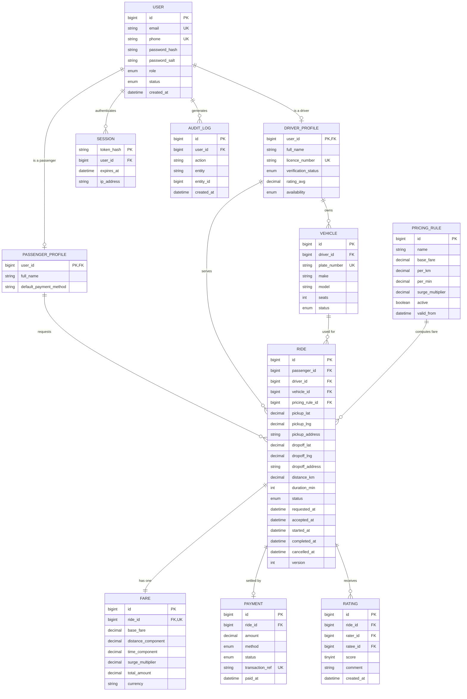

---

### 4.2 Normalization Justification (1NF $\to$ 2NF $\to$ 3NF)

| Normal Form | Rule Requirement | How ViaMe Satisfies the Requirement |
| :--- | :--- | :--- |
| **1NF (First Normal Form)** | Atomic values per column, distinct record identifiers, no repeating arrays. | All attributes contain scalar values (e.g., coordinates are partitioned into `pickup_lat` and `pickup_lng`; names into `full_name`; ratings into single integer `score`). Primary keys exist for every table. |
| **2NF (Second Normal Form)** | Satisfies 1NF and guarantees no partial dependencies on composite keys. | All tables use single-attribute surrogate integer/bigint primary keys (`id`, `user_id`, `token_hash`). Partial key dependencies are mathematically impossible. |
| **3NF (Third Normal Form)** | Satisfies 2NF and eliminates all transitive dependencies ($X \to Y$ and $Y \to Z$). | In `ride`, passenger and driver profile attributes are not duplicated; only foreign keys (`passenger_id`, `driver_id`) are stored. Vehicle technical data is segregated into `vehicle`. Pricing parameters are stored in `pricing_rule` and calculated fare breakdowns in `fare`, decoupling current configuration from historical transaction receipts. |

---

### 4.3 Complete Physical MySQL DDL Script (`schema.sql`)

```sql
-- =====================================================================
-- ViaMe Urban Transport Booking System - Physical Database Schema (3NF)
-- DBMS: MySQL 8.0+ | Engine: InnoDB | Character Set: utf8mb4
-- =====================================================================

DROP DATABASE IF EXISTS viame_db;
CREATE DATABASE viame_db CHARACTER SET utf8mb4 COLLATE utf8mb4_unicode_ci;
USE viame_db;

-- 1. Base Users Table (Identity & Authentication)
CREATE TABLE user (
    id BIGINT AUTO_INCREMENT PRIMARY KEY,
    email VARCHAR(150) NOT NULL UNIQUE,
    phone VARCHAR(20) NOT NULL UNIQUE,
    password_hash VARCHAR(255) NOT NULL,
    password_salt VARCHAR(64) NOT NULL,
    role ENUM('PASSENGER', 'DRIVER', 'ADMIN') NOT NULL,
    status ENUM('ACTIVE', 'PENDING', 'SUSPENDED') NOT NULL DEFAULT 'ACTIVE',
    created_at TIMESTAMP DEFAULT CURRENT_TIMESTAMP,
    INDEX idx_user_email (email),
    INDEX idx_user_role (role)
) ENGINE=InnoDB;

-- 2. Passenger Profiles Table (1-to-1 Subtype)
CREATE TABLE passenger_profile (
    user_id BIGINT PRIMARY KEY,
    full_name VARCHAR(120) NOT NULL,
    default_payment_method VARCHAR(20) DEFAULT 'CASH',
    wallet_balance DECIMAL(10, 2) NOT NULL DEFAULT 0.00 CHECK (wallet_balance >= 0.00),
    CONSTRAINT fk_passenger_user FOREIGN KEY (user_id) REFERENCES user(id) ON DELETE CASCADE
) ENGINE=InnoDB;

-- 3. Driver Profiles Table (1-to-1 Subtype)
CREATE TABLE driver_profile (
    user_id BIGINT PRIMARY KEY,
    full_name VARCHAR(120) NOT NULL,
    licence_number VARCHAR(40) NOT NULL UNIQUE,
    verification_status ENUM('PENDING', 'APPROVED', 'REJECTED') NOT NULL DEFAULT 'PENDING',
    rating_avg DECIMAL(3, 2) DEFAULT 5.00 CHECK (rating_avg BETWEEN 1.00 AND 5.00),
    availability ENUM('ONLINE', 'OFFLINE', 'ON_TRIP') NOT NULL DEFAULT 'OFFLINE',
    current_lat DECIMAL(9, 6) DEFAULT 4.051056,
    current_lng DECIMAL(9, 6) DEFAULT 9.767869,
    total_earnings DECIMAL(12, 2) NOT NULL DEFAULT 0.00 CHECK (total_earnings >= 0.00),
    CONSTRAINT fk_driver_user FOREIGN KEY (user_id) REFERENCES user(id) ON DELETE CASCADE,
    INDEX idx_driver_availability (availability)
) ENGINE=InnoDB;

-- 4. Vehicles Table
CREATE TABLE vehicle (
    id BIGINT AUTO_INCREMENT PRIMARY KEY,
    driver_id BIGINT NOT NULL UNIQUE,
    plate_number VARCHAR(20) NOT NULL UNIQUE,
    make VARCHAR(40) NOT NULL,
    model VARCHAR(40) NOT NULL,
    seats INT NOT NULL CHECK (seats BETWEEN 1 AND 15),
    status ENUM('PENDING', 'ACTIVE', 'INACTIVE') NOT NULL DEFAULT 'PENDING',
    CONSTRAINT fk_vehicle_driver FOREIGN KEY (driver_id) REFERENCES driver_profile(user_id) ON DELETE CASCADE
) ENGINE=InnoDB;

-- 5. Pricing Rules Table (Dynamic Tariff Configuration)
CREATE TABLE pricing_rule (
    id BIGINT AUTO_INCREMENT PRIMARY KEY,
    name VARCHAR(60) NOT NULL,
    base_fare DECIMAL(10, 2) NOT NULL CHECK (base_fare >= 0.00),
    per_km DECIMAL(10, 2) NOT NULL CHECK (per_km >= 0.00),
    per_min DECIMAL(10, 2) NOT NULL CHECK (per_min >= 0.00),
    surge_multiplier DECIMAL(4, 2) NOT NULL DEFAULT 1.00 CHECK (surge_multiplier BETWEEN 1.00 AND 3.00),
    active BOOLEAN NOT NULL DEFAULT TRUE,
    valid_from TIMESTAMP DEFAULT CURRENT_TIMESTAMP
) ENGINE=InnoDB;

-- 6. Rides Table (Core Lifecycle Entity with Optimistic Concurrency Locking)
CREATE TABLE ride (
    id BIGINT AUTO_INCREMENT PRIMARY KEY,
    passenger_id BIGINT NOT NULL,
    driver_id BIGINT DEFAULT NULL,
    vehicle_id BIGINT DEFAULT NULL,
    pricing_rule_id BIGINT NOT NULL,
    pickup_lat DECIMAL(9, 6) NOT NULL,
    pickup_lng DECIMAL(9, 6) NOT NULL,
    pickup_address VARCHAR(255) NOT NULL,
    dropoff_lat DECIMAL(9, 6) NOT NULL,
    dropoff_lng DECIMAL(9, 6) NOT NULL,
    dropoff_address VARCHAR(255) NOT NULL,
    distance_km DECIMAL(6, 2) NOT NULL CHECK (distance_km > 0.00),
    duration_min INT NOT NULL CHECK (duration_min >= 0),
    status ENUM('REQUESTED', 'ASSIGNED', 'DRIVER_EN_ROUTE', 'ARRIVED', 'IN_PROGRESS', 'COMPLETED', 'CANCELLED', 'NO_DRIVER_FOUND') NOT NULL DEFAULT 'REQUESTED',
    requested_at TIMESTAMP DEFAULT CURRENT_TIMESTAMP,
    accepted_at TIMESTAMP NULL DEFAULT NULL,
    started_at TIMESTAMP NULL DEFAULT NULL,
    completed_at TIMESTAMP NULL DEFAULT NULL,
    cancelled_at TIMESTAMP NULL DEFAULT NULL,
    version INT NOT NULL DEFAULT 1, -- Optimistic locking column
    CONSTRAINT fk_ride_passenger FOREIGN KEY (passenger_id) REFERENCES passenger_profile(user_id),
    CONSTRAINT fk_ride_driver FOREIGN KEY (driver_id) REFERENCES driver_profile(user_id),
    CONSTRAINT fk_ride_vehicle FOREIGN KEY (vehicle_id) REFERENCES vehicle(id),
    CONSTRAINT fk_ride_pricing FOREIGN KEY (pricing_rule_id) REFERENCES pricing_rule(id),
    INDEX idx_ride_status (status),
    INDEX idx_ride_requested_at (requested_at)
) ENGINE=InnoDB;

-- 7. Fares Table (Immutable Financial Itemization per Ride)
CREATE TABLE fare (
    id BIGINT AUTO_INCREMENT PRIMARY KEY,
    ride_id BIGINT NOT NULL UNIQUE,
    base_fare DECIMAL(10, 2) NOT NULL CHECK (base_fare >= 0.00),
    distance_component DECIMAL(10, 2) NOT NULL CHECK (distance_component >= 0.00),
    time_component DECIMAL(10, 2) NOT NULL CHECK (time_component >= 0.00),
    surge_multiplier DECIMAL(4, 2) NOT NULL CHECK (surge_multiplier >= 1.00),
    total_amount DECIMAL(10, 2) NOT NULL CHECK (total_amount >= 0.00),
    currency VARCHAR(3) NOT NULL DEFAULT 'XAF',
    CONSTRAINT fk_fare_ride FOREIGN KEY (ride_id) REFERENCES ride(id) ON DELETE CASCADE
) ENGINE=InnoDB;

-- 8. Payments Table
CREATE TABLE payment (
    id BIGINT AUTO_INCREMENT PRIMARY KEY,
    ride_id BIGINT NOT NULL,
    amount DECIMAL(10, 2) NOT NULL CHECK (amount >= 0.00),
    method ENUM('CARD', 'MOBILE_MONEY', 'CASH', 'WALLET') NOT NULL,
    status ENUM('PENDING', 'PAID', 'FAILED', 'REFUNDED') NOT NULL DEFAULT 'PENDING',
    transaction_ref VARCHAR(80) UNIQUE,
    paid_at TIMESTAMP NULL DEFAULT NULL,
    CONSTRAINT fk_payment_ride FOREIGN KEY (ride_id) REFERENCES ride(id) ON DELETE CASCADE
) ENGINE=InnoDB;

-- 9. Ratings Table
CREATE TABLE rating (
    id BIGINT AUTO_INCREMENT PRIMARY KEY,
    ride_id BIGINT NOT NULL,
    rater_id BIGINT NOT NULL,
    ratee_id BIGINT NOT NULL,
    score TINYINT NOT NULL CHECK (score BETWEEN 1 AND 5),
    comment VARCHAR(500) DEFAULT NULL,
    created_at TIMESTAMP DEFAULT CURRENT_TIMESTAMP,
    CONSTRAINT fk_rating_ride FOREIGN KEY (ride_id) REFERENCES ride(id) ON DELETE CASCADE,
    CONSTRAINT fk_rating_rater FOREIGN KEY (rater_id) REFERENCES user(id),
    CONSTRAINT fk_rating_ratee FOREIGN KEY (ratee_id) REFERENCES user(id)
) ENGINE=InnoDB;

-- 10. Sessions Table (Active Authentication Token Management)
CREATE TABLE session (
    token_hash VARCHAR(64) PRIMARY KEY,
    user_id BIGINT NOT NULL,
    expires_at TIMESTAMP NOT NULL,
    ip_address VARCHAR(45) DEFAULT NULL,
    CONSTRAINT fk_session_user FOREIGN KEY (user_id) REFERENCES user(id) ON DELETE CASCADE
) ENGINE=InnoDB;

-- 11. Audit Logs Table (Immutable Regulatory Tracking)
CREATE TABLE audit_log (
    id BIGINT AUTO_INCREMENT PRIMARY KEY,
    user_id BIGINT DEFAULT NULL,
    action VARCHAR(60) NOT NULL,
    entity VARCHAR(40) DEFAULT NULL,
    entity_id BIGINT DEFAULT NULL,
    created_at TIMESTAMP DEFAULT CURRENT_TIMESTAMP,
    CONSTRAINT fk_audit_user FOREIGN KEY (user_id) REFERENCES user(id) ON DELETE SET NULL
) ENGINE=InnoDB;
```

---

## 5. Detailed Requirements & 10 Core Use Case Specifications

### 5.1 Functional Requirements Matrix
- **FR-AUTH-01:** System must allow registering Passengers and Drivers with unique email and validated phone number.
- **FR-AUTH-02:** Passwords must be hashed using BCrypt prior to database insertion.
- **FR-PASS-01:** Passengers can view real-time fare estimates based on pickup and destination coordinates.
- **FR-PASS-02:** Passengers can book a ride, monitor driver proximity, and cancel within 2 minutes without penalty.
- **FR-DRV-01:** Drivers can toggle between ONLINE (`AVAILABLE`) and OFFLINE status.
- **FR-DRV-02:** Drivers receive audio/visual pop-up notifications for ride requests within a 5km radius.
- **FR-TRIP-01:** State progression must follow strict state machine rules (`REQUESTED` $\to$ `ASSIGNED` $\to$ `DRIVER_ARRIVED` $\to$ `IN_PROGRESS` $\to$ `COMPLETED`).
- **FR-PAY-01:** System supports Cash and Digital Wallet; wallet debits must occur inside an ACID transaction.
- **FR-ADM-01:** Administrators can configure base tariffs, per-km rates, and surge multipliers.
- **FR-REP-01:** System generates 5 automated, dynamic business analytics reports exportable to PDF/CSV.

---

### 5.2 10 Detailed Use Case Specifications

```
========================================================================================
USE CASE 01: User Registration and Account Provisioning
========================================================================================
Primary Actor:    Unregistered Guest (Passenger or Driver)
Preconditions:    Application is running; guest is on the Register view.
Trigger:          Guest submits the registration form.
Main Flow:
  1. Guest fills in Full Name, Email, Phone Number, Password, and selects Role.
  2. If Driver is selected, UI presents additional fields: License Number, Vehicle Model, Plate.
  3. Controller triggers InputValidator (checks email format, phone digits, password >= 8 chars).
  4. Controller calls AuthenticationService.registerUser(dto).
  5. Service hashes password via PasswordHasher.hash(plainPassword).
  6. Service calls UserDAO to insert base record and PassengerDAO/DriverDAO for role-specific data.
  7. System displays success alert and routes guest to Login view.
Alternative Flow: Email or phone already registered -> System displays duplicate error message.
Exception Flow:   Database unavailable -> System logs error, shows "Service Unavailable" dialog.
Postconditions:   New user record persists in MySQL; initial wallet balance set to 0.00.

========================================================================================
USE CASE 02: User Authentication & Session Establishment
========================================================================================
Primary Actor:    Registered User (Passenger, Driver, or Admin)
Preconditions:    User has an active account.
Trigger:          User enters credentials and clicks "Log In".
Main Flow:
  1. User enters registered email and password.
  2. AuthController passes credentials to AuthenticationService.
  3. Service queries UserDAO for the user record by email.
  4. Service verifies hash via BCrypt.checkpw().
  5. User object is loaded into SessionManager.
  6. Controller reads user role and loads corresponding dashboard FXML.
Alternative Flow: Password mismatch -> Error counter increments; error alert shown.
Exception Flow:   Account flagged as suspended -> System denies login and shows contact support.
Postconditions:   Global SessionManager holds the authenticated user reference.

========================================================================================
USE CASE 03: Trip Fare Estimation
========================================================================================
Primary Actor:    Passenger
Preconditions:    Passenger is authenticated and viewing Passenger Dashboard.
Trigger:          Passenger selects Pickup and Destination zones from drop-downs.
Main Flow:
  1. Passenger inputs departure and destination locations.
  2. UI sends coordinates to FareCalculationService.
  3. Service calculates Euclidean distance (km) and multiplies by category rate.
  4. Service queries TripDAO for active requests vs active drivers to assess surge pricing.
  5. Estimated fare is displayed on the UI along with estimated travel time.
Alternative Flow: Identical pickup and destination -> System warns "Points must be distinct".
Postconditions:   No database alteration; temporary estimate displayed on screen.

========================================================================================
USE CASE 04: Trip Request Creation and Dispatch Broadcast
========================================================================================
Primary Actor:    Passenger
Preconditions:    Fare estimated; passenger is eligible to request.
Trigger:          Passenger clicks "Request ViaMe Now".
Main Flow:
  1. Passenger selects payment method (Cash or In-App Wallet).
  2. PassengerController verifies sufficient wallet balance if Wallet selected.
  3. TripService instantiates Trip entity with status = REQUESTED.
  4. TripDAO writes the trip to the database.
  5. DriverMatchingService queries available drivers within 5km radius.
  6. System broadcasts trip alert to eligible driver consoles.
  7. UI initiates 30-second countdown for driver response.
Alternative Flow: No drivers within 5km -> System widens search or informs passenger.
Postconditions:   Trip record created with status REQUESTED; passenger UI displays radar.

========================================================================================
USE CASE 05: Driver Trip Acceptance & Lock
========================================================================================
Primary Actor:    Driver
Preconditions:    Driver status is AVAILABLE; ride request broadcast is received.
Trigger:          Driver clicks "Accept" within the 30-second window.
Main Flow:
  1. Driver clicks "Accept".
  2. DriverController invokes TripService.acceptTrip(tripId, driverId).
  3. TripService begins a JDBC transaction with pessimistic lock (SELECT FOR UPDATE).
  4. System verifies trip status is still REQUESTED.
  5. Trip record is updated to ASSIGNED with driver_id set.
  6. Driver status updated to ON_TRIP.
  7. Transaction commits.
  8. Driver UI displays pickup navigation; Passenger UI updates with driver details.
Alternative Flow: Another driver accepted first -> Transaction rolls back; alert displayed.
Postconditions:   Trip locked to driver; driver and passenger UIs synchronize.

========================================================================================
USE CASE 06: Ride Execution (Arrival to Destination)
========================================================================================
Primary Actor:    Driver
Preconditions:    Trip status is ASSIGNED.
Trigger:          Driver reaches pickup, then destination.
Main Flow:
  1. Driver arrives at pickup location and clicks "Arrived".
  2. Status transitions to DRIVER_ARRIVED; passenger UI alerts "Driver is waiting".
  3. Passenger boards; Driver clicks "Start Trip".
  4. Status transitions to IN_PROGRESS; start_time recorded.
  5. Vehicle completes route; Driver clicks "End Trip".
  6. Status transitions to ARRIVED_DESTINATION; end_time recorded.
  7. Payment settlement process is triggered automatically.
Exception Flow:   Passenger fails to show -> Driver cancels after 5 mins; no-show fee billed.
Postconditions:   Trip marked ready for payment settlement.

========================================================================================
USE CASE 07: Atomic Payment Settlement
========================================================================================
Primary Actor:    System (Automated Trigger) / Driver
Preconditions:    Trip status is ARRIVED_DESTINATION.
Trigger:          Driver completes trip.
Main Flow:
  1. PaymentService initiates an atomic transaction.
  2. Gross fare, 20% platform commission, and 80% driver net earnings are computed.
  3. If payment method is WALLET:
     a. Debit passenger wallet balance.
     b. Credit driver accumulated earnings.
  4. If payment method is CASH:
     a. Driver collects total fare from passenger.
     b. Platform commission is debited from driver balance/recorded as owed.
  5. PaymentDAO inserts record with status = SETTLED.
  6. Trip status transitions to COMPLETED.
  7. Transaction commits.
Postconditions:   Trip fully paid, balances adjusted, digital receipt displayed.

========================================================================================
USE CASE 08: Driver & Passenger Rating / Review
========================================================================================
Primary Actor:    Passenger and Driver
Preconditions:    Trip status is COMPLETED.
Trigger:          Post-trip modal dialog opens.
Main Flow:
  1. User selects a star rating (1 to 5) and optionally types feedback.
  2. Controller passes Review entity to ReviewDAO.
  3. Review record is inserted into database.
  4. Target user's aggregate rating is updated via recalculation query.
Postconditions:   Review saved; driver/passenger profile rating updated.

========================================================================================
USE CASE 09: Digital Wallet Top-Up
========================================================================================
Primary Actor:    Passenger
Preconditions:    Passenger is on the Wallet view.
Trigger:          Passenger specifies amount and payment voucher/simulation code.
Main Flow:
  1. Passenger enters amount (e.g., 5,000 XAF) and chooses provider.
  2. System validates amount > 500 XAF.
  3. PaymentService executes credit transaction.
  4. PassengerDAO increments wallet_balance.
  5. Audit log entry recorded.
  6. Passenger balance refreshes dynamically on UI.
Postconditions:   Passenger wallet balance increased.

========================================================================================
USE CASE 10: Dynamic Business Intelligence Report Generation
========================================================================================
Primary Actor:    Admin / Dispatcher
Preconditions:    Admin is logged into Admin Console.
Trigger:          Admin selects report type and date interval, clicks "Generate".
Main Flow:
  1. Admin chooses one of the 5 pre-configured reports (e.g., Revenue Ledger).
  2. Controller calls ReportService with selected date parameters.
  3. Service queries MySQL with analytical aggregate SQL queries.
  4. Result set mapped into observable collection of report DTOs.
  5. UI populates TableView and renders JavaFX BarChart/PieChart.
  6. Admin clicks "Export to CSV/Text" to save report locally.
Postconditions:   Visual report rendered on screen and exportable file generated.
```

---

## 6. Implementation Architecture & Java OOP Design

### 6.1 Demonstration of Core OOP Principles
- **Encapsulation:** All model properties (`userId`, `fareAmount`, `status`) are strictly `private` or `protected` with controlled getters, setters, and business invariant checking.
- **Inheritance:** `Passenger`, `Driver`, and `Admin` inherit common identity attributes (`email`, `passwordHash`, `role`) from abstract base class `User`.
- **Polymorphism & Abstraction:** 
  - `GenericDAO<T>` interface establishes common CRUD contracts implemented by `UserDAOImpl`, `TripDAOImpl`, etc.
  - `FareStrategy` interface allows swapping between `StandardFareStrategy`, `NightFareStrategy`, and `SurgeFareStrategy` dynamically at runtime.
- **Collections & Generics:** Extensive usage of `List<Trip>`, `Map<Integer, Driver>`, `ObservableList<ReportDTO>`, and generic DAOs.
- **Modern Date/Time API:** Usage of `java.time.LocalDateTime` and `java.time.Duration` instead of legacy `java.util.Date`.

---

### 6.2 Key Java Classes Implementation Examples

#### 1. Thread-Safe Database Connection Manager (`DBConnection.java`)
```java
package com.viame.dao;

import java.sql.Connection;
import java.sql.DriverManager;
import java.sql.SQLException;

public class DBConnection {
    private static final String URL = "jdbc:mysql://localhost:3306/viame_db?useSSL=false&allowPublicKeyRetrieval=true&serverTimezone=UTC";
    private static final String USER = "root";
    private static final String PASSWORD = "password"; // Configure per environment

    private static DBConnection instance;
    private Connection connection;

    private DBConnection() {
        try {
            Class.forName("com.mysql.cj.jdbc.Driver");
            this.connection = DriverManager.getConnection(URL, USER, PASSWORD);
        } catch (ClassNotFoundException | SQLException e) {
            throw new RuntimeException("Database connection initialization failed", e);
        }
    }

    public static synchronized DBConnection getInstance() {
        try {
            if (instance == null || instance.getConnection().isClosed()) {
                instance = new DBConnection();
            }
        } catch (SQLException e) {
            instance = new DBConnection();
        }
        return instance;
    }

    public Connection getConnection() {
        return this.connection;
    }
}
```

#### 2. Abstract Domain Supertype (`User.java`)
```java
package com.viame.model;

import com.viame.model.enums.UserRole;
import java.time.LocalDateTime;

public abstract class User {
    protected int userId;
    protected String fullName;
    protected String email;
    protected String phoneNumber;
    protected String passwordHash;
    protected UserRole role;
    protected LocalDateTime createdAt;

    public User(int userId, String fullName, String email, String phoneNumber, String passwordHash, UserRole role) {
        this.userId = userId;
        this.fullName = fullName;
        this.email = email;
        this.phoneNumber = phoneNumber;
        this.passwordHash = passwordHash;
        this.role = role;
        this.createdAt = LocalDateTime.now();
    }

    public int getUserId() { return userId; }
    public String getFullName() { return fullName; }
    public String getEmail() { return email; }
    public String getPhoneNumber() { return phoneNumber; }
    public UserRole getRole() { return role; }
    public String getPasswordHash() { return passwordHash; }
}
```

#### 3. Concrete Subtype (`Passenger.java`)
```java
package com.viame.model;

import com.viame.model.enums.UserRole;
import com.viame.exception.InsufficientFundsException;

public class Passenger extends User {
    private double walletBalance;
    private double passengerRating;

    public Passenger(int userId, String fullName, String email, String phoneNumber, String passwordHash, double walletBalance, double passengerRating) {
        super(userId, fullName, email, phoneNumber, passwordHash, UserRole.PASSENGER);
        this.walletBalance = walletBalance;
        this.passengerRating = passengerRating;
    }

    public double getWalletBalance() { return walletBalance; }
    public double getPassengerRating() { return passengerRating; }

    public void creditWallet(double amount) {
        if (amount <= 0) throw new IllegalArgumentException("Credit amount must be positive");
        this.walletBalance += amount;
    }

    public void debitWallet(double amount) {
        if (amount > this.walletBalance) {
            throw new InsufficientFundsException("Insufficient funds: Available " + walletBalance + ", Required " + amount);
        }
        this.walletBalance -= amount;
    }
}
```

#### 4. Transactional DAO Implementation (`TripDAOImpl.java`)
```java
package com.viame.dao.impl;

import com.viame.dao.DBConnection;
import com.viame.dao.TripDAO;
import com.viame.model.Trip;
import com.viame.model.enums.TripStatus;
import com.viame.exception.DatabaseException;

import java.sql.*;

public class TripDAOImpl implements TripDAO {

    @Override
    public boolean lockAndAssignTrip(int tripId, int driverId) {
        String selectSql = "SELECT status FROM trips WHERE trip_id = ? FOR UPDATE";
        String updateTrip = "UPDATE trips SET status = 'ASSIGNED', driver_id = ? WHERE trip_id = ?";
        String updateDriver = "UPDATE drivers SET status = 'ON_TRIP' WHERE user_id = ?";

        Connection conn = DBConnection.getInstance().getConnection();
        try {
            conn.setAutoCommit(false); // Begin ACID Transaction

            try (PreparedStatement checkStmt = conn.prepareStatement(selectSql)) {
                checkStmt.setInt(1, tripId);
                try (ResultSet rs = checkStmt.executeQuery()) {
                    if (rs.next()) {
                        String currentStatus = rs.getString("status");
                        if (!"REQUESTED".equals(currentStatus)) {
                            conn.rollback();
                            return false; // Already taken or cancelled
                        }
                    } else {
                        conn.rollback();
                        return false;
                    }
                }
            }

            try (PreparedStatement tripStmt = conn.prepareStatement(updateTrip);
                 PreparedStatement drvStmt = conn.prepareStatement(updateDriver)) {
                
                tripStmt.setInt(1, driverId);
                tripStmt.setInt(2, tripId);
                tripStmt.executeUpdate();

                drvStmt.setInt(1, driverId);
                drvStmt.executeUpdate();

                conn.commit(); // Commit Transaction
                return true;
            }
        } catch (SQLException e) {
            try { conn.rollback(); } catch (SQLException ex) { /* log */ }
            throw new DatabaseException("Failed to lock and assign trip", e);
        } finally {
            try { conn.setAutoCommit(true); } catch (SQLException e) { /* log */ }
        }
    }
}
```

---

## 7. Functionality and 5 Meaningful Business Intelligence Reports

The platform integrates 5 SQL analytical aggregate reports accessible via the Admin Console:

| Report ID & Title | Primary Metrics & Data Fields | Practical Business Value & Analytical Goal |
| :--- | :--- | :--- |
| **Report 1: Daily Revenue & Commission Ledger** | `Date`, `Total Trips Completed`, `Gross Revenue`, `Platform Commission (20%)`, `Driver Payouts (80%)` | Audits gross turnover, tracks company revenues vs payouts, and prevents accounting discrepancies. |
| **Report 2: Driver Performance & Evaluation Matrix** | `Driver ID`, `Driver Name`, `Trips Completed`, `Cancellations`, `Acceptance Rate (%)`, `Average Rating` | Identifies high-performing drivers for bonuses and flags drivers with low ratings for retraining or deactivation. |
| **Report 3: Peak Hour & High-Demand Route Heatmap** | `Hour of Day (0-23)`, `Pickup Zone`, `Total Request Count`, `Average Surge Multiplier` | Enables strategic fleet positioning and dynamic dispatching in high-demand zones. |
| **Report 4: Trip Cancellation & Attrition Analysis** | `Reason/Party (Passenger vs Driver)`, `Total Cancelled`, `Avg Wait Time Before Cancellation`, `Lost Revenue` | Identifies friction points in driver response times causing passenger drop-offs. |
| **Report 5: Customer Loyalty & Spending Segmentation** | `Passenger ID`, `Name`, `Completed Rides`, `Total Spend`, `Wallet Usage vs Cash %`, `Tier (Gold/Silver/Bronze)` | Enables targeted marketing campaigns, loyalty rewards, and retention strategies. |

---

## 8. Security Architecture, Input Validation & Concurrency Controls

### 8.1 Security & Cryptography
1. **Password Hashing:** Passwords are never stored in plaintext. Passwords are salted and hashed using BCrypt (`BCrypt.hashpw(plainText, BCrypt.gensalt(12))`).
2. **SQL Injection Neutralization:** String concatenation in SQL statements is strictly prohibited across the codebase. Every database query is parameterized via `java.sql.PreparedStatement`.
3. **Session Management & RBAC:** A singleton `SessionManager` tracks user identity in memory. Controllers check privileges before opening administrative views:
   ```java
   if (SessionManager.getInstance().getCurrentUser().getRole() != UserRole.ADMIN) {
       AlertHelper.showError("Access Denied", "Administrative privileges required.");
       return;
   }
   ```

### 8.2 Concurrency & Race Condition Resolution
In a multi-user transport system, multiple drivers might click "Accept" on the same trip simultaneously. ViaMe resolves this using **pessimistic locking**:
```sql
SELECT status FROM trips WHERE trip_id = ? FOR UPDATE;
```
The first driver thread locks the database row; subsequent threads wait until the transaction commits, see the status has changed to `ASSIGNED`, and are cleanly notified that the trip is no longer available.

---

## 9. Comprehensive Testing Plan & Quality Assurance (Task T8)

ViaMe implements a structured, multi-tier testing strategy combining **JUnit 5**, **Mockito**, and automated integration test suites.

### 9.1 Test Suite Organization

```
src/test/java
└── com.viame
    ├── unit
    │   ├── model
    │   │   ├── PassengerTest.java          # Wallet debit/credit logic, invariant checks
    │   │   ├── DriverTest.java             # Status transitions, rating bounds
    │   │   └── TripTest.java               # State machine validation rules
    │   ├── service
    │   │   ├── AuthenticationServiceTest.java # BCrypt hashing, invalid credential handling
    │   │   ├── FareCalculationServiceTest.java# Base rates, distance math, surge algorithms
    │   │   └── TripServiceTest.java        # Dispatch logic, driver matching mock tests
    │   └── util
    │       ├── InputValidatorTest.java     # Email, phone, license plate regex patterns
    │       └── PasswordHasherTest.java     # Hash generation and verification tests
    ├── integration
    │   ├── dao
    │   │   ├── UserDAOTest.java            # CRUD persistence against test database
    │   │   ├── TripDAOTest.java            # Row locking, status update verification
    │   │   └── PaymentDAOTest.java         # Atomic transaction verification
    │   └── flow
    │       ├── BookingLifecycleIT.java     # End-to-end trip booking & settlement flow
    │       └── ConcurrencyRaceConditionIT.java # Multi-threaded double-acceptance test
    └── security
        ├── SqlInjectionResistanceTest.java # Verifies parameterized query safety
        └── RoleAccessControlTest.java      # Enforces role permissions per action
```

### 9.2 Key Test Cases Matrix

| Test ID | Test Category | Target Component | Test Scenario / Condition | Expected Outcome |
| :--- | :--- | :--- | :--- | :--- |
| **TC-UNIT-01** | Unit | `Passenger.java` | Attempt to debit wallet with an amount greater than available balance. | Throws `InsufficientFundsException`; balance remains unchanged. |
| **TC-UNIT-02** | Unit | `Trip.java` | Attempt to transition trip status from `REQUESTED` directly to `COMPLETED`. | Throws `TripStateException`; illegal transition blocked. |
| **TC-UNIT-03** | Unit | `FareCalculationService` | Calculate fare for 10.5 km under standard conditions (Base=500, Rate=200/km). | Returns exactly $500 + (10.5 \times 200) = 2,600\text{ XAF}$. |
| **TC-UNIT-04** | Unit | `PasswordHasher` | Verify correct password against BCrypt hash; verify wrong password. | Returns `true` for matching password, `false` for mismatched string. |
| **TC-INT-01** | Integration | `TripDAOImpl` | Execute `lockAndAssignTrip()` on a trip with status `REQUESTED`. | Returns `true`; status in database updates to `ASSIGNED`. |
| **TC-INT-02** | Integration | `PaymentService` | Execute wallet payment when passenger has sufficient balance. | Decrements passenger wallet, credits driver earnings, and inserts payment record in a single atomic commit. |
| **TC-CONC-01** | Concurrency | `TripDAOImpl` | Spawn 5 concurrent threads calling `lockAndAssignTrip()` on the same trip ID. | Exactly 1 thread succeeds (returns `true`); 4 threads return `false`. Data remains consistent. |
| **TC-SEC-01** | Security | `UserDAOImpl` | Input SQL injection string `' OR '1'='1` in email field during login query. | Prepared statement escapes input; returns `Optional.empty()` without SQL syntax error or leak. |

---

## 10. 12-Week Implementation Phase Structure & Deliverables

The project execution roadmap is structured across 12 distinct weeks, aligned with the course syllabus and review checkpoints:

```
+---------------------------------------------------------------------------------------------------------+
|                                        12-WEEK PROJECT TIMELINE                                         |
+--------------------+-----------------------------------------------+------------------------------------+
| Weeks 1 - 3        | Phase 1: Requirements, Analysis & Architecture| Deliverable: SRS & Analysis Doc    |
| Week 4 (CHECKPOINT)| Phase 2: UML Modeling & Formal Architecture   | Deliverable: UML Design Document   |
| Weeks 5 - 6        | Phase 3: Database Engineering & Normalization | Deliverable: DB Schema & DDL       |
| Weeks 7 - 8        | Phase 4: Core Implementation & Prototype      | Deliverable: Working Core (Mid-Term|
| Weeks 9 - 10       | Phase 5: Advanced Features, Security & QA     | Deliverable: Feature-Complete Build|
| Weeks 11 - 12      | Phase 6: Final Deployment & Defense Prep      | Deliverable: Final Submission & Demo|
+--------------------+-----------------------------------------------+------------------------------------+
```

### Phase 1: Inception, Requirements & Analysis (Weeks 1 – 3)
- **Week 1:** Problem definition, scope boundaries, Git repository initialization (`ViaMe`), role assignments, team agreement.
  - *Deliverable:* Project Proposal.
- **Week 2:** Functional requirements (FR), Non-functional requirements (NFR), business constraints, and actor boundary definitions.
  - *Deliverable:* Requirements Specification Document (SRS).
- **Week 3:** Detailed use case specifications (10 full flows), domain problem analysis, and activity workflows.
  - *Deliverable:* System Analysis Document.

### Phase 2: UML Design & Architecture Review (Week 4 — Checkpoint 1)
- **Week 4:** Authoring the complete UML diagram suite: Use Case diagram (20+ use cases), Class diagram, 5 Sequence diagrams, 3 Activity diagrams, Trip State Machine, Component and Deployment diagrams.
  - *Deliverable:* **UML Design Document (Milestone Checkpoint 1 Defense)**.

### Phase 3: Database Design & Normalization (Weeks 5 – 6)
- **Week 5:** Conceptual ERD modeling, logical schema definition, 3NF normalization justification, constraints, foreign key cascades, and indexing strategies.
  - *Deliverable:* Database Design Document.
- **Week 6:** Physical MySQL script generation (`schema.sql`), automated sample data seeding, JDBC connection pool testing (`DBConnection.java`).
  - *Deliverable:* Runnable SQL DDL & Connection Baseline.

### Phase 4: Core Layer Implementation (Weeks 7 – 8 — Checkpoint 2)
- **Week 7:** Building the core Java domain classes (`User`, `Passenger`, `Driver`, `Trip`, `Payment`), abstract classes, interfaces, and base DAOs.
  - *Deliverable:* Working Core Domain Layer.
- **Week 8:** Integrating JavaFX Scene Builder `.fxml` views with controllers, basic authentication, and simple trip creation.
  - *Deliverable:* **Mid-Project Prototype (Milestone Checkpoint 2 Defense)**.

### Phase 5: Advanced Features, Security & Testing (Weeks 9 – 10 — Checkpoint 3)
- **Week 9:** Dynamic fare calculation (surge pricing), multi-role simulation views (Passenger, Driver Radar, Admin), and the 5 analytical BI reports.
  - *Deliverable:* Feature-Complete Build.
- **Week 10:** Integration of BCrypt password hashing, session RBAC, comprehensive JUnit test suites, and bug tracking log.
  - *Deliverable:* **Test Report & Quality Assurance Document (Milestone Checkpoint 3)**.

### Phase 6: Polish, Documentation & Final Engineering Defense (Weeks 11 – 12)
- **Week 11:** Finalizing user manual, developer API manual, system installation guide, and presentation slide deck.
  - *Deliverable:* Release Candidate (RC).
- **Week 12:** Live demonstration dry-run, question-and-answer defense preparation, final Git tag release.
  - *Deliverable:* **Final Project Submission Package & Live Oral Defense**.

---

## 11. Final Engineering Defense Guide (Rubric Questions & Answers)

During the final oral examination (20-30 minutes per group), the lecturer will assess both individual understanding and group cohesion. Below are prepared model answers for anticipated technical questions:

### Q1: Where and why are Encapsulation, Inheritance, Abstraction, and Polymorphism used?
> **Answer:**
> - **Encapsulation:** Used across all domain classes (e.g., `Passenger`, `Trip`) where all instance fields are private and manipulated exclusively through validated methods (e.g., `debitWallet()` enforces positive amounts and prevents overdrafts).
> - **Inheritance:** An abstract base class `User` defines common attributes (`userId`, `fullName`, `email`, `role`), which are inherited by `Passenger`, `Driver`, and `Admin`, avoiding duplicate code and establishing clean subtype relationships.
> - **Abstraction:** Implemented via interfaces such as `GenericDAO<T>`, which abstracts database mechanics away from business logic, and `FareStrategy`, which abstracts dynamic fare calculations.
> - **Polymorphism:** The `UserDAO` returns instances typed as `User`, which at runtime behave as `Passenger` or `Driver`. Similarly, the `FareCalculationService` invokes `strategy.calculateFare()` dynamically based on current market demand.

### Q2: How does the system handle concurrent operations and prevent race conditions?
> **Answer:**
> When multiple drivers attempt to accept the same trip simultaneously, we prevent duplicate assignments by using **pessimistic locking** in MySQL through JDBC. The query `SELECT status FROM trips WHERE trip_id = ? FOR UPDATE` locks the specific row within a transactional block (`setAutoCommit(false)`). The first driver thread checks that the status is `REQUESTED`, updates it to `ASSIGNED`, sets the `driver_id`, and commits. Subsequent threads that unblock will read status `ASSIGNED`, roll back, and receive a message that the trip has already been claimed.

### Q3: How is SQL Injection prevented throughout the application?
> **Answer:**
> SQL Injection is eliminated by using **parameterized `PreparedStatement` instances** for every database query across all DAO implementations. User input is never concatenated directly into SQL strings. The JDBC driver treats user input strictly as literal data rather than executable SQL commands, neutralizing malicious payloads such as `' OR '1'='1`.

### Q4: What happens if the database server becomes temporarily unavailable?
> **Answer:**
> The `DBConnection` singleton wraps connection attempts in robust try-catch blocks and checks `connection.isClosed()` before returning. If the database drops, the DAO layer catches `SQLException` and wraps it in an unchecked `DatabaseException`, which the Service and Controller layers catch gracefully. Instead of crashing, the JavaFX UI displays an error alert via `AlertHelper.showError("Database Error", "Unable to reach database server. Please check connection.")`, preserving application stability and informing the user.

### Q5: How is 3NF justified in your database schema?
> **Answer:**
> - **1NF:** Every column contains atomic values, each table has a primary key, and there are no repeating groups.
> - **2NF:** All non-key attributes are fully dependent on the primary key, since all tables use single-column primary keys (no composite keys exist, so partial dependencies cannot occur).
> - **3NF:** There are no transitive dependencies. For example, in the `TRIPS` table, we store only foreign keys `passenger_id` and `driver_id`. We do not duplicate passenger names or vehicle registration numbers within `TRIPS`; those are resolved via relational joins with `USERS` and `VEHICLES`.

---

## 12. Verification & Deliverables Checklist

- [x] **Project Alignment:** Fully addresses Project 5 (Taxi / Transport Booking System) for Institut Saint Jean.
- [x] **Technology Stack:** Pure Java (JDK 17+), JavaFX with Scene Builder FXML, and MySQL 8.x via JDBC.
- [x] **Architecture Justification:** Complete 5-tier layered design with written rationale and package structure.
- [x] **Complete UML Suite:** Mermaid-rendered Use Case, Class, Sequence (5), Activity (3), State Machine, Component, and Deployment diagrams.
- [x] **Database Implementation:** Conceptual ERD, 3NF normalization proof, and complete runnable SQL DDL (`schema.sql`).
- [x] **Core Requirements:** 10 detailed use case specifications, functional/non-functional requirements, and business rules.
- [x] **Business Intelligence:** 5 analytical reports detailing calculations and administrative utility.
- [x] **Security & Integrity:** BCrypt hashing, SQL injection prevention, ACID transactions, and pessimistic locking.
- [x] **Phase Roadmap:** 12-week schedule with student role responsibilities and checkpoint deliverables.
- [x] **Defense Preparation:** Antcipated examination questions and model answers aligned with the grading rubric.
