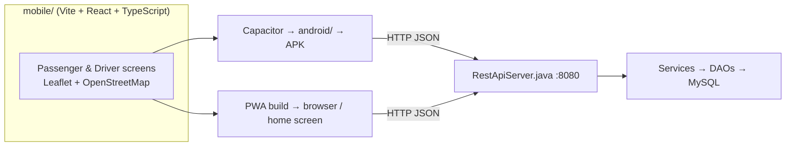

# ViaMe — Hybrid Mobile Client Implementation Guide
## Student 3: DANIELLA (UI/UX & Mobile Developer)

- **Project:** ViaMe — Intelligent Multi-Role Urban Transport & Taxi Booking System (Project 5)
- **Course:** Java Programming II (Institut Saint Jean - ISJ, 2026/2027)
- **Lead Architect & Reviewer:** Emmanuel Oyono (Student 2)
- **Assigned Git Branch:** `feature/daniella-mobile-ui`
- **Scope:** Mobile only. This guide **replaces PART A** (the Android section) of [`STUDENT_3_DANIELLA_MOBILE_UI_GUIDE.md`](STUDENT_3_DANIELLA_MOBILE_UI_GUIDE.md). PART B (the JavaFX desktop consoles) is unchanged.

---

## 1. The Decision: One Codebase, Two Deliverables

We are **not** writing a pure Kotlin/Java Android app. Instead we build **one mobile web app** with real maps and ship it in two forms:

| Deliverable | What it is | Why we need it |
| :--- | :--- | :--- |
| **1. Android APK** (`mobile/android/`) | The web app wrapped into a real Android Studio project with **Capacitor** → `app-debug.apk` | Satisfies the syllabus wording: *"Android app … Android → REST API → Java backend → MySQL"* |
| **2. PWA** (`mobile/dist/`) | The same app opened from a phone's browser, installable to the home screen | Lets examiners open the app on their own phones during the defense |

**Why:** real interactive maps (Leaflet + OpenStreetMap) are free, need no API key or credit card, and are much quicker to build than Google Maps SDK on native Android.



> [!CAUTION]
> **The exam rule still applies.** The mobile app talks **only** to `RestApiServer` on port `8080`. No MySQL driver, no SQL, no direct database access in `mobile/`.

---

## 2. Tech Stack

| Layer | Choice | Notes |
| :--- | :--- | :--- |
| Build tool | **Vite** | Fast dev server, hot reload |
| UI | **React 18 + TypeScript** | Type-safe DTOs that match the REST contract |
| Styling | **Tailwind CSS** | Mobile-first; design for a 360–430 px wide screen |
| Maps | **Leaflet + react-leaflet** with **OpenStreetMap** tiles | Free, no API key. Keep the "© OpenStreetMap contributors" credit visible (OSM licence requirement) |
| Routing state | **react-router** | `/login`, `/register`, `/passenger`, `/driver` |
| PWA | **vite-plugin-pwa** | Manifest + service worker |
| Android wrapper | **Capacitor 6** (`@capacitor/core`, `@capacitor/android`) | Generates a real Android Studio project |
| HTTP | `fetch` (wrapped in one `api.ts` client) | See §5 for the important networking rules |

---

## 3. Getting Started

```bash
git checkout main && git pull origin main
git checkout -b feature/daniella-mobile-ui     # or: git checkout feature/daniella-mobile-ui && git merge main

# Create the mobile app at the repository root
npm create vite@latest mobile -- --template react-ts
cd mobile
npm install
npm install leaflet react-leaflet react-router-dom
npm install -D @types/leaflet tailwindcss @tailwindcss/vite vite-plugin-pwa
npm install @capacitor/core @capacitor/android
npm install -D @capacitor/cli
npx cap init ViaMe com.viame.mobile --web-dir=dist
```

Start the backend (from the repo root, in another terminal) and the mobile dev server:

```bash
# Backend REST API (port 8080) — MySQL must be running with database/schema.sql loaded
mvn compile exec:java -Dexec.mainClass=com.viame.api.RestApiServer

# Mobile app
cd mobile && npm run dev -- --host
```

### Target folder structure

```
mobile/
├── capacitor.config.ts
├── vite.config.ts
├── index.html
├── public/                 # icons (192px, 512px) for the manifest
├── src/
│   ├── api/
│   │   ├── client.ts       # fetch wrapper (base URL, errors, text/plain trick)
│   │   ├── endpoints.ts    # one function per REST endpoint
│   │   └── types.ts        # request/response DTOs (see §6)
│   ├── data/hotspots.ts    # Douala hotspots (see §7)
│   ├── components/         # MapView, FareCard, DriverCard, StatusStepper, RadarModal, WalletSheet, RatingSheet
│   ├── pages/              # LoginPage, RegisterPage, PassengerPage, DriverPage
│   ├── session.ts          # userId / role / avatarUrl in localStorage
│   └── main.tsx
└── android/                # generated by `npx cap add android` — commit it
```

---

## 4. Screens to Build

### 4.1 Login & Register
- [ ] Email + password login → `POST /api/auth/login` → store `userId`, `role`, `avatarUrl` → go to `/passenger` or `/driver` based on `role`.
- [ ] "Demo Passenger" / "Demo Driver" quick-fill buttons for the oral defense.
- [ ] Register tab toggle: **Passenger** (name, phone, email, password, payment method) / **Driver** (+ licence number, plate number, make, model, seats).
- [ ] Show the backend `error` message on failure (e.g. HTTP 401).

### 4.2 Passenger Screen (map first)
- [ ] **Full-screen Leaflet map** centred on Douala `[4.0511, 9.7679]`, zoom 13, with markers for the 7 hotspots (§7).
- [ ] Bottom sheet: pick **pickup** and **dropoff** (tap a marker or choose from a list).
- [ ] Draw a line between pickup and dropoff (a straight `Polyline` is enough — the backend computes distance with Haversine).
- [ ] **Fare card** → `POST /api/fare/estimate`: distance km, duration min, surge ×, **total in XAF**.
- [ ] **Nearby drivers** → `GET /api/drivers/available?lat=&lng=&radius=5.0`: show the count and list (name, distance, rating, avatar).
  - ⚠️ This endpoint does **not** return driver GPS coordinates, so drivers cannot be placed accurately on the map. Show them as a list, or place them around the pickup as clearly decorative "radar" dots.
- [ ] Payment selector: `WALLET` / `CASH`.
- [ ] **Request ride** → `POST /api/trips/request`. On **HTTP 402** (insufficient funds) open the wallet top-up sheet.
- [ ] **Status stepper**: `REQUESTED → ASSIGNED → DRIVER_EN_ROUTE → ARRIVED → IN_PROGRESS → COMPLETED` (plus `CANCELLED`, `NO_DRIVER_FOUND`).
- [ ] **Cancel ride** → `POST /api/trips/cancel`.
- [ ] **Wallet top-up sheet** → `POST /api/wallet/topup` (minimum **500 XAF**, enforced by the backend).
- [ ] **Rating sheet** (1–5 stars + comment) after `COMPLETED` — see §8 gap G5.

### 4.3 Driver Screen
- [ ] **ONLINE / OFFLINE** toggle — see §8 gap G3.
- [ ] **Incoming ride radar modal**: pickup, dropoff, fare, **30-second countdown ring**, sound + `navigator.vibrate([200,100,200])`, buttons **Accept** / **Decline** — see §8 gap G2 for how requests are discovered.
- [ ] **Accept** → `POST /api/trips/accept`. If the call fails (another driver took it first — pessimistic locking), show "Ride already taken".
- [ ] **Sequential action button** → `POST /api/trips/status` with `action`:
  `EN_ROUTE` ("Driver En Route") → `ARRIVED` ("Arrived at Pickup") → `START` ("Start Ride") → `COMPLETE` ("Complete Ride").
- [ ] **Earnings card**: gross, 20% platform commission, 80% driver payout (computed client-side from completed fares in the current session, until gap G6 is closed).

### 4.4 UX rules
- Thumb-reachable primary buttons at the bottom; minimum touch target 44 px.
- Always show loading and error states; never leave a button "dead".
- Format money as `1 850 XAF` (`Intl.NumberFormat('fr-CM')`).

---

## 5. Networking Rules (read carefully — this is where hybrid apps break)

### 5.1 Base URL
Put it in `mobile/.env`, never hard-code it:

```
VITE_API_BASE=http://10.0.2.2:8080      # Android emulator → your PC's localhost
# VITE_API_BASE=http://192.168.1.50:8080   # phone on the same Wi-Fi → your PC's LAN IP
```

### 5.2 Native CORS & JSON Support (Fully Configured in Backend)
`RestApiServer` now natively handles HTTP `OPTIONS` preflight requests returning `204 No Content` with:
- `Access-Control-Allow-Origin: *`
- `Access-Control-Allow-Methods: GET, POST, PUT, DELETE, OPTIONS`
- `Access-Control-Allow-Headers: Content-Type, Authorization, X-Requested-With`

You can use standard `Content-Type: application/json` directly with `fetch` or `axios`.
Furthermore, the backend JSON parser is now token-aware and safely handles string values containing commas (e.g. `"Akwa Palace Hotel, Douala"`) and colons without truncation.

```ts
// src/api/client.ts
const BASE = import.meta.env.VITE_API_BASE;

export class ApiError extends Error {
  constructor(public status: number, message: string) { super(message); }
}

export async function post<T>(path: string, body: unknown): Promise<T> {
  const res = await fetch(`${BASE}${path}`, {
    method: 'POST',
    headers: { 'Content-Type': 'application/json' },
    body: JSON.stringify(body),
  });
  const data = await res.json();
  if (!res.ok) throw new ApiError(res.status, data.error ?? 'Request failed');
  return data as T;
}

export async function get<T>(path: string): Promise<T> {
  const res = await fetch(`${BASE}${path}`);
  const data = await res.json();
  if (!res.ok) throw new ApiError(res.status, data.error ?? 'Request failed');
  return data as T;
}
```

### 5.3 Capacitor / Android cleartext HTTP
The backend uses plain `http://`. By default Capacitor serves the app from `https://localhost`, and Android blocks HTTPS pages from calling `http://` APIs (mixed content). Use this config:

```ts
// mobile/capacitor.config.ts
import type { CapacitorConfig } from '@capacitor/cli';

const config: CapacitorConfig = {
  appId: 'com.viame.mobile',
  appName: 'ViaMe',
  webDir: 'dist',
  server: {
    androidScheme: 'http',   // allow calls to the http:// REST API
    cleartext: true,
  },
};
export default config;
```

### 5.4 PWA limits on a local network
- Service workers, "Add to Home Screen" and the Geolocation API only work over **HTTPS** or on `localhost`.
- If examiners open `http://192.168.x.x:5173` on their phones, the app **works normally in the browser**, but it cannot be **installed** and **cannot use GPS**. That's fine for the demo: the user chooses the pickup from the hotspots (this is also why §7 exists).
- If you want installation to work in the room, deploy `mobile/dist` to an HTTPS host. The API still has to be reachable, though, so for the defense the plan is: **APK + browser tab over LAN**.

---

## 6. REST Contract (verified against `RestApiServer.java`)

All endpoints are fully implemented and verified in [`RestApiServer.java`](../../src/main/java/com/viame/api/RestApiServer.java):

| Category | Endpoint | Method | Request body / query | Success response |
| :--- | :--- | :---: | :--- | :--- |
| **Auth** | `/api/auth/login` | `POST` | `{email, password}` | `200 {success, userId, email, role, status, avatarUrl}` · `401 {error}` |
| **Auth** | `/api/auth/register/passenger` | `POST` | `{email, phone, password, fullName, paymentMethod?}` (`WALLET` default) | `201 {success, userId, fullName, walletBalance}` |
| **Auth** | `/api/auth/register/driver` | `POST` | `{email, phone, password, fullName, licenceNumber, plateNumber, make, model, seats?}` | `201 {success, userId, verificationStatus}` |
| **Fare** | `/api/fare/estimate` | `POST` | `{pickupLat, pickupLng, dropoffLat, dropoffLng}` | `200 {distanceKm, durationMin, baseFare, surge, totalAmount, currency}` |
| **Dispatch** | `/api/drivers/available` | `GET` | `?lat=&lng=&radius=` | `200 {count, drivers:[{driverId, name, distanceKm, rating, avatarUrl}]}` |
| **Driver Duty** | `/api/drivers/availability` | `POST` | `{driverId, status}` (`ONLINE` / `OFFLINE`) | `200 {success, driverId, status}` |
| **Driver Duty** | `/api/drivers/availability` | `GET` | `?driverId=` | `200 {success, driverId, status}` |
| **Driver Earnings**| `/api/drivers/earnings` | `GET` | `?driverId=` | `200 {success, driverId, netEarnings, commission, grossRevenue, completedTrips, ratingAvg, availability}` |
| **Trips** | `/api/trips/request` | `POST` | `{passengerId, pickupLat, pickupLng, pickupAddress, dropoffLat, dropoffLng, dropoffAddress, paymentMethod}` | `201 {success, tripId, status, distanceKm, durationMin}` · `402` insufficient funds |
| **Trips** | `/api/trips/accept` | `POST` | `{tripId, driverId}` | `200 {success, tripId, status, driverId}` · `400` if already taken |
| **Trips** | `/api/trips/status` | `GET` | `?tripId=` OR `?passengerId=` | `200 {success, tripId, passengerId, driverId, status, pickupAddress, dropoffAddress, distanceKm, ...}` |
| **Trips** | `/api/trips/status` | `POST` | `{tripId, driverId, action, paymentMethod?}` — `action` ∈ `EN_ROUTE`, `ARRIVED`, `START`, `COMPLETE` | `200 {success, tripId, status, ...}` |
| **Trips** | `/api/trips/pending` | `GET` | — | `200 {count, trips:[{tripId, passengerId, pickupAddress, dropoffAddress, ...}]}` (Driver Radar) |
| **Trips** | `/api/trips/cancel` | `POST` | `{tripId, userId, isPassenger}` | `200 {success, tripId, status}` |
| **Wallet** | `/api/wallet/balance` | `GET` | `?passengerId=` | `200 {success, passengerId, balance}` |
| **Wallet** | `/api/wallet/topup` | `POST` | `{passengerId, amount, provider?}` | `200 {success, passengerId, newBalance}` |
| **Ratings** | `/api/ratings` | `POST` | `{tripId, raterId, rateeId, score, comment?}` | `201 {success, ratingId, score}` |
| **Ratings** | `/api/ratings` | `GET` | `?userId=` | `200 {userId, count, ratings:[...]}` |
| **Avatar** | `/api/avatar` | `GET` | `?seed=&mood=&size=&shape=&animated=` | SVG image (use directly in ``) |
| **Health** | `/api/health` | `GET` | — | `200 {status:"UP"}` |

All errors return standard HTTP status codes with `{"error": "..."}`.
All endpoints support CORS `OPTIONS` preflight requests (`204 No Content`).

---

## 7. Douala Hotspots (coordinates taken from `database/schema.sql` seed data)

```ts
// src/data/hotspots.ts
export const HOTSPOTS = [
  { name: 'Akwa Palace Hotel',         lat: 4.051056, lng: 9.767869 },
  { name: 'Bonanjo Administrative Zone', lat: 4.043500, lng: 9.691200 },
  { name: 'Bonamoussadi Market',       lat: 4.075833, lng: 9.718611 },
  { name: 'Makepe Saint Tropez',       lat: 4.092100, lng: 9.735400 },
  { name: 'Douala International Airport', lat: 4.006111, lng: 9.719444 },
  { name: 'Deido Grand Moulin',        lat: 4.062500, lng: 9.711111 },
  { name: 'Ndokoti Intersection',      lat: 4.045000, lng: 9.742000 },
] as const;
```

Minimal map component:

```tsx
// src/components/MapView.tsx
import 'leaflet/dist/leaflet.css';
import { MapContainer, TileLayer, Marker, Polyline, Popup } from 'react-leaflet';
import { HOTSPOTS } from '../data/hotspots';

export function MapView({ pickup, dropoff, onPick }: {
  pickup?: [number, number]; dropoff?: [number, number];
  onPick: (h: typeof HOTSPOTS[number]) => void;
}) {
  return (
    <MapContainer center={[4.0511, 9.7679]} zoom={13} className="h-full w-full">
      <TileLayer
        url="https://{s}.tile.openstreetmap.org/{z}/{x}/{y}.png"
        attribution="&copy; OpenStreetMap contributors"
      />
      {HOTSPOTS.map(h => (
        <Marker key={h.name} position={[h.lat, h.lng]} eventHandlers={{ click: () => onPick(h) }}>
          <Popup>{h.name}</Popup>
        </Marker>
      ))}
      {pickup && dropoff && <Polyline positions={[pickup, dropoff]} />}
    </MapContainer>
  );
}
```

> [!NOTE]
> Leaflet's default marker icons often break with Vite bundling. Fix this by importing the icon images from `leaflet/dist/images/` and setting `L.Icon.Default.mergeOptions({...})`, or by using your own SVG `divIcon` (a taxi icon looks better anyway).
>
> The OpenStreetMap tile server is fine for development and the demo, but it is **not** meant for heavy production traffic. Map tiles also need internet access on the device.

---

## 8. Backend Status: All Endpoints Live (Zero Mocks Needed!)

> [!IMPORTANT]
> **COMPLETED & DEPLOYED (Nov 2026):**  
> All 7 previously identified gaps (G1 through G7) have been implemented, tested, and pushed directly to `RestApiServer.java` on `main`:
> 1. ✅ **`GET /api/trips/status?tripId=...` & `GET /api/trips/status?passengerId=...`**: Live passenger status polling.
> 2. ✅ **`GET /api/trips/pending`**: Live driver radar pending requests polling.
> 3. ✅ **`POST /api/drivers/availability`**: Driver duty switch (`ONLINE` / `OFFLINE`).
> 4. ✅ **`GET /api/wallet/balance?passengerId=...`**: Instant passenger wallet balance lookup.
> 5. ✅ **`POST /api/ratings`**: 1-to-5 star evaluation submission for completed trips.
> 6. ✅ **`GET /api/drivers/earnings?driverId=...`**: Driver earnings card (gross, 20% commission, net payout, trips count, rating).
> 7. ✅ **Native CORS `OPTIONS` Preflight & Comma-Safe JSON**: Standard `application/json` is supported on all endpoints without workarounds.
>
> You can now connect all mobile screens directly to the real backend with **zero mocked data**.

---

## 9. Building the Deliverables

### PWA
```ts
// mobile/vite.config.ts
import { defineConfig } from 'vite';
import react from '@vitejs/plugin-react';
import tailwindcss from '@tailwindcss/vite';
import { VitePWA } from 'vite-plugin-pwa';

export default defineConfig({
  plugins: [
    react(),
    tailwindcss(),
    VitePWA({
      registerType: 'autoUpdate',
      manifest: {
        name: 'ViaMe', short_name: 'ViaMe',
        theme_color: '#0f172a', background_color: '#0f172a',
        display: 'standalone', orientation: 'portrait', start_url: '/',
        icons: [
          { src: '/icon-192.png', sizes: '192x192', type: 'image/png' },
          { src: '/icon-512.png', sizes: '512x512', type: 'image/png' },
        ],
      },
    }),
  ],
});
```
```bash
npm run build          # → mobile/dist
npm run preview -- --host
```

### Android APK
```bash
npm run build
npx cap add android    # first time only — creates mobile/android/
npx cap sync android   # after every web build
npx cap open android   # opens Android Studio → Run ▶ on emulator, or Build > Build APK(s)
```
The APK will be at `mobile/android/app/build/outputs/apk/debug/app-debug.apk`.

> [!TIP]
> Requirements: Android Studio (latest stable) with its bundled JDK 17+, and an emulator (API 30+). In the emulator, `10.0.2.2` is your PC's `localhost`. On a physical phone, use your PC's LAN IP and allow port 8080 through the Windows firewall.

---

## 10. Defense Demo Script (≈ 3 minutes)

1. Start MySQL + `RestApiServer` + the JavaFX Admin console on the laptop.
2. **Emulator (APK):** log in as **Demo Passenger** → choose Akwa → Bonamoussadi on the map → fare card → request ride (WALLET).
3. **Second device (browser over LAN):** log in as **Demo Driver** → go ONLINE → radar modal with countdown → Accept.
4. Driver taps En Route → Arrived → Start → Complete; the passenger stepper follows.
5. Passenger rates the driver; the JavaFX Admin console shows the new trip and revenue.
6. Talking point: *"Neither the APK nor the browser touches MySQL. Both go Android/Web → REST API → Services → DAO → MySQL."*

---

## 11. Acceptance Checklist (before opening the Pull Request)

- [ ] `mobile/` builds with `npm run build` and has no TypeScript errors.
- [ ] `mobile/android/` opens in Android Studio and produces `app-debug.apk`.
- [ ] No MySQL/JDBC dependency or SQL anywhere in `mobile/`.
- [ ] The base URL comes from `.env`; `.env` is git-ignored and `.env.example` is committed.
- [ ] Login, fare estimate, ride request, accept, status transitions, cancel and top-up work against the real backend.
- [ ] Mocks (if any) are only enabled with `VITE_USE_MOCKS=true` and show a "demo mode" badge.
- [ ] The OpenStreetMap attribution is visible on the map.
- [ ] `mvn clean compile` and `mvn test` on the backend still pass (you should not have touched it).
- [ ] Add `mobile/node_modules/`, `mobile/dist/`, `mobile/android/app/build/` and `mobile/android/.gradle/` to `.gitignore`.

```bash
git add mobile/ .gitignore
git commit -m "feat(mobile): hybrid PWA + Capacitor Android client with Leaflet maps"
git push -u origin feature/daniella-mobile-ui
# then open a Pull Request to main — Emmanuel reviews and merges
```

---

## 12. AI Assistant Prompt (copy into your IDE assistant)

```text
@docs/tasks/STUDENT_3_DANIELLA_HYBRID_MOBILE_GUIDE.md @src/main/java/com/viame/api/RestApiServer.java
You are helping Student 3 (Daniella) build the ViaMe hybrid mobile client in mobile/
(Vite + React + TypeScript + Tailwind + react-leaflet + vite-plugin-pwa + Capacitor Android).
Follow the guide exactly: use the REST contract in §6 (field names as in RestApiServer.java),
send POST bodies with Content-Type text/plain, flat JSON with no commas in string values,
Douala hotspots from §7, and put G1–G6 behind mockable functions in src/api/endpoints.ts.
Never add database access to the mobile app. Do not modify any file outside mobile/.
```
